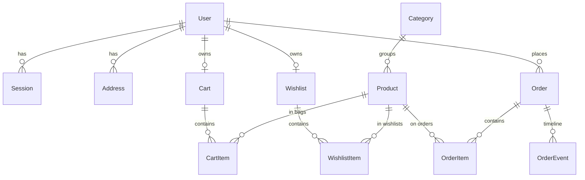

# AURELIA — Master Project Architecture Document (PAD) v1.0

**Classification:** Internal Engineering Reference
**Status:** DEFINITIVE, PRODUCTION-LOCKED BLUEPRINT
**Companion Documents:** `AGENTS.md` (agent commands/quirks), `CLAUDE.md` (agent workflow), `README.md` (user-facing overview)
**Last Updated:** 2026-10-14
**Audience:** Senior Engineers, Tech Leads, DevOps, and Onboarding Engineers
**Rule:** Every architectural decision in this document traces to a specific rationale. Nothing is here "because it's popular."

---

## Table of Contents

1. [System Overview & Decisions](#1-system-overview--decisions)
2. [High-Level System Topology](#2-high-level-system-topology)
3. [Application Architecture](#3-application-architecture)
4. [Data Architecture](#4-data-architecture)
5. [Design System Reference](#5-design-system-reference)
6. [Security Architecture](#6-security-architecture)
7. [Testing Strategy](#7-testing-strategy)
8. [Build & Deployment](#8-build--deployment)
9. [Developer Handbook](#9-developer-handbook)
10. [Known Issues & Outstanding Tasks](#10-known-issues--outstanding-tasks)
11. [Key Files Reference](#11-key-files-reference)
12. [Glossary](#12-glossary)

---

## 1. System Overview & Decisions

### 1.1 Document Metadata & Purpose

AURELIA (storefront brand: **VELOUR**) is a production-grade luxury fashion e-commerce application: storefront, customer accounts, and admin console. It is a **functional superset** of a visual-only reference prototype (`pastel-aurelia-fashion-edit.base44.app`) whose measured behavior is: working login, cart drawer, and search overlay only — every commerce button is inert and every catalog route 404s. The clone mandate is therefore twofold and non-negotiable:

1. **Visual parity** — resting-state pixels of every shared surface match the reference's computed styles.
2. **Functional superset** — every inert interaction becomes a real, server-backed commerce flow.

How to use this document: new engineers read §2–§4 for the mental model; debuggers start at §3.3 (invariants) and §10; reviewers of tech choices read §1.3 (ADRs).

### 1.2 Technology Stack Summary

| Layer | Technology | Version (pinned) | Key Rationale |
|---|---|---|---|
| Web framework | Next.js (App Router, Turbopack, standalone output) | 16.4.2 | RSC + server actions give a zero-API mutation seam; standalone ships a self-contained server |
| UI runtime | React | 19.3.1 | `useActionState` + adjust-state-during-render; Compiler-compatible patterns enforced by lint |
| Language | TypeScript (strict) | 5.9.3 | Action envelopes and DTOs typed end-to-end |
| Styling | Tailwind CSS v4 (CSS-first) | 4.3.3 | Reference extracted as v3-style bare HSL tokens; v4 `@theme inline` with full `hsl()` literals reproduces them exactly |
| ORM / DB | Prisma + SQLite | 6.19.3 | Single-writer file DB fits the demo/single-node scope; schema-relative URL contract |
| Validation | Zod | 3.25.76 | One schema language across forms, actions, admin updates |
| Auth | Custom scrypt + DB sessions | — | No external IdP dependency; reference has email/password only |
| Unit testing | Vitest (node env) | 3.2.7 | Fast pure-seam coverage (money, URL contract, schemas, limiter, HMAC) |
| E2E testing | Playwright | 1.64.1 | Boots the real production standalone against a scratch DB; chromium + mobile profiles |
| Icons | lucide-react | 0.545.0 | Same icon set as the reference (stroke width 2) |
| Fonts | Cormorant Garamond + Montserrat (self-hosted) | — | Reference typefaces; `@font-face` + `font-display: swap` in `public/fonts/` |

### 1.3 Architecture Decision Records

**ADR-001: Server actions are the only mutation seam**

- **Context:** The reference prototype performs mutations nowhere (inert buttons); the clone needs cart/checkout/wishlist/auth/admin writes with zero bespoke REST surface, and every write must be server-authoritative.
- **Decision:** All mutations live in `"use server"` modules under `src/lib/actions/`. Reads happen in RSC pages via Prisma directly. REST exists only for three read/subscribe endpoints (`/api/health`, `/api/search`, `/api/newsletter`).
- **Rationale:** Server actions give typed, CSRF-safe, progressively-enhanced mutations with no API layer to keep in sync; the repo-family architecture (ecommerce-store) proved the pattern at 4-endpoint REST whitelist scale.
- **Consequences:** (+) one place to audit writes; (+) client store always re-syncs from action DTOs (server truth wins); (−) actions are not curl-able — E2E must drive the UI.
- **Alternatives rejected:** REST route handlers + SWR mutations (duplicates validation + typing); tRPC (extra runtime for 8 actions).

**ADR-002: SQLite via schema-relative `DATABASE_URL`, re-anchored at runtime**

- **Context:** The database must live at `<repoRoot>/db/custom.db` regardless of which process opens it (dev server, seed script, standalone production server whose cwd is `.next/standalone`).
- **Decision:** `.env` pins `DATABASE_URL="file:../db/custom.db"` (the Prisma CLI's schema-relative form). `src/lib/db-path.ts` reproduces the CLI rule (walk up from cwd to the nearest `prisma/schema.prisma`, resolve the URL against it). `src/lib/db.ts` passes every URL through that resolver before constructing `PrismaClient`. Absolute `file:` URLs pass through untouched.
- **Rationale:** The generated client bakes the schema directory at generate time, which MOVES in the standalone bundle; the resolver makes dev, tooling, and the standalone agree on one physical file.
- **Consequences:** (+) one contract for all runtimes; (−) the resolver's `existsSync` reads make file tracing copy `prisma/schema.prisma` into the bundle — which would re-anchor relative URLs to `<bundle>/db/` (nonexistent). Hence the E2E webServer uses an absolute URL (pass-through path), and deployments must too.
- **Alternatives rejected:** absolute URL in `.env` (breaks the documented contract + tests); raw client default (broke in standalone: "Unable to open the database file").

**ADR-003: Custom scrypt auth with DB-backed sessions and HMAC cookies**

- **Context:** Email/password auth matching the reference's login card; no third-party IdP; rate-limitable.
- **Decision:** `scrypt` password hashing (`s1$<salt>$<hash>` format), `Session` rows in SQLite, session id inside an HMAC-signed httpOnly cookie (`AUTH_SECRET`), guest carts/wishlists keyed by 192-bit random tokens merged into the user's rows at login.
- **Rationale:** Zero external dependencies, full control over rate limiting and session revocation (logout deletes the row), and the guest→member merge maps 1:1 onto the cart token model.
- **Consequences:** (+) revocable, auditable, no vendor lock; (−) no OAuth (the Google button on the auth card is a visual parity stub, explicitly titled as such).
- **Alternatives rejected:** NextAuth (heavier than needed; reference has no OAuth); localStorage auth (the pre-transformation SPA's model — plaintext, unrevocable).

**ADR-004: Single client state seam (`StoreProvider`), server-truth re-sync**

- **Context:** Cart, wishlist, user, and four overlay states are consumed across many client islands; naive per-component fetching caused drift in the reference family.
- **Decision:** One React context (`StoreProvider`) initialized from server props; mutations return fresh DTOs that the caller writes back via `setCart`/`setWishlist`. Router refresh re-syncs via the adjust-state-during-render pattern (last-seen-props in state — no setState-in-effect).
- **Rationale:** Server actions are async and cheap; keeping the client cache as a mirror of action responses eliminates optimistic-math bugs (totals, counts) by construction.
- **Consequences:** (+) no client money math at all; (−) every mutation pays an action round-trip (acceptable at this scale).
- **Alternatives rejected:** Zustand (second state mechanism); optimistic updates (contradicts server-truth invariant).

**ADR-005: Tailwind v4 CSS-first with pinned parity literals**

- **Context:** The reference was built on Tailwind v3-style tokens (bare HSL triplets) and its mobile menu uses `flex flex-col gap-5` stacking. v4 changes both semantics (bare triplets resolve transparent; `space-y-*` rewrites its selector).
- **Decision:** All tokens are declared as full `hsl(...)` literals in `@theme inline` (`src/app/globals.css`); parity stacks use flex `gap-*` exclusively; fonts are self-hosted `@font-face`.
- **Rationale:** Computed-style parity is the product requirement; the pins are enforced by E2E geometry assertions (`tests/e2e/mobile-navigation.spec.ts` measures bounding boxes, not class names).
- **Consequences:** (+) byte-identical rendering semantics; (−) future maintainers must not "simplify" `gap-5` → `space-y-5` (the v4 trap the pins guard).

**ADR-006: Production standalone E2E with per-project auth sessions**

- **Context:** Dev-server E2E misses build/asset failures (and did: the standalone initially served SSR HTML with 404 chunks — zero hydration); rate limits punish per-test logins; the logout spec destroys server-side sessions.
- **Decision:** Playwright boots `.next/standalone/server.js` on :3100 against a scratch `db/e2e.db` (global-setup pushes schema + seeds). Two setup projects (`setup-chromium`, `setup-mobile`) each sign in once and persist `tests/e2e/.auth/{chromium,mobile}.json`. The webServer passes an absolute `DATABASE_URL` (ADR-002 pass-through).
- **Rationale:** Testing the shipped artifact; per-project sessions make projects order-independent despite session-revoking specs; one login per project stays under the 10/15min limiter.
- **Consequences:** (+) hydration/asset regressions are caught; (−) `npm run build` must precede `npm run test:e2e`.

**ADR-007: Demo card settlement without a PSP**

- **Context:** The reference has no payment provider; the clone must demo checkout end-to-end.
- **Decision:** Card orders are Luhn-validated, only the last 4 digits are stored, and payment is settled immediately (`paymentStatus: "paid"`); COD orders settle as `null` (courier). No real charge path exists.
- **Rationale:** Demonstrates the full order lifecycle (placed → in_transit → delivered) without SAQ scope or live keys.
- **Consequences:** (+) zero external integration; (−) obviously not production payment — documented here and in the checkout UI copy ("demo processor, no real charge").

## 2. High-Level System Topology

```text
┌────────────────────────────── Browser (chromium desktop / iPhone-14 profile) ──────────────────────────────┐
│  RSC payload (force-dynamic pages)  ·  Client islands (header, drawers, wizard)  ·  StoreProvider context   │
└───────────────┬──────────────────────────────────────────────────────────────────────────┬─────────────────┘
                │ GET (RSC/nav)                                                            │ POST server actions
┌───────────────▼──────────────────────────────────────────────────────────────────────────▼─────────────────┐
│  Next.js 16.4 server (dev: turbopack :3000 · prod: .next/standalone/server.js)                             │
│  ├─ (storefront) route group: + AnnouncementBar, Header, MobileNav, CartDrawer, SearchOverlay,             │
│  │                              Newsletter, Footer  (chrome composed in the group layout)                  │
│  ├─ (auth) route group: chrome-less login/register (measured slate cards)                                  │
│  ├─ /api/health · /api/search · /api/newsletter                     (the only REST endpoints)              │
│  ├─ security headers (next.config.ts): Permissions-Policy, COOP,           │
│  │   Referrer-Policy, nosniff, HSTS, X-Frame-Options: DENY                 │
│  ├─ src/proxy.ts ← per-request CSP with a fresh nonce (N-1: prod script-src│
│  │   'self' 'nonce-…' — NO 'unsafe-inline'; dev keeps the F-7 escape hatch;│
│  │   directives unit-pinned in src/lib/csp.ts)                             │
│  ├─ src/instrumentation.ts ← boot-time env guard (AUTH_SECRET mandatory    │
│  │   in production) + sweeper schedule (expired sessions, idle guest carts)│
│  └─ src/lib/actions/*  ← THE mutation seam (Zod + authz + rate limits + transactions)                      │
└───────────────┬────────────────────────────────────────────────────────────────────────────────────────────┘
                │ Prisma 6.19 (datasource URL re-anchored via src/lib/db-path.ts)
       ┌────────▼─────────┐        ┌──────────────────────────┐
       │ SQLite (file)    │        │ External (static assets) │
       │  db/custom.db    │        │  images.unsplash.com     │
       │  13 models       │        │  (unoptimized passthrough)│
       └──────────────────┘        └──────────────────────────┘
```

Single-node, single-process, single-writer. Scaling characteristics are documented in §8.4; the rate limiter is in-memory (per-instance) by the same scope decision.

## 3. Application Architecture

### 3.1 The Layer Model

```
Layer 0: Database — SQLite file at <repoRoot>/db/custom.db. 13 Prisma models. Money = integer cents.
Layer 1: Domain seams (src/lib) — pure + server modules: money, db-path, cart (+ cart-dto), auth, rate-limit,
         validation (Zod), order-token, delivery, products (DTO mapper). Pure modules never import servers.
Layer 2: Mutation seam (src/lib/actions) — "use server" only. Zod-parse → authz → transaction → ActionResult<T>.
Layer 3: RSC pages (src/app) — force-dynamic server components; fetch via Prisma, render DTOs; route groups
         own chrome: (storefront) renders the full chrome, (auth) renders none.
Layer 4: Client islands (src/components) — interactivity only; state via StoreProvider; mutations via actions.
Golden rule: data flows DOWN (props), mutations flow UP (actions), and the client never derives money math.
```

### 3.2 Annotated Directory Structure

```text
luxury-fashion-store/
├── AGENTS.md / CLAUDE.md / README.md / Project_Architecture_Document.md
├── next.config.ts              ← standalone output, dev-origin allowlist, static security headers (CSP lives in src/proxy.ts)
├── src/proxy.ts                ← per-request nonce CSP (N-1; request+response headers, matcher skips api/_next assets)
├── playwright.config.ts        ← standalone E2E on :3100, per-project auth, absolute e2e DB URL
├── vitest.config.ts            ← unit layer (matches *.test.ts only)
├── .env                        ← DATABASE_URL (schema-relative), AUTH_SECRET, NEXT_PUBLIC_SITE_URL
├── db/                         ← git-ignored; custom.db (dev) + e2e.db (E2E scratch)
├── prisma/
│   ├── schema.prisma           ← 13 models, SQLite, no enums (Zod-validated strings)
│   └── seed.ts                 ← deterministic (fixed scrypt salts) + idempotent (upserts)
├── scripts/
│   └── assemble-standalone.mjs ← postbuild: copies .next/static + public/ into the bundle
├── public/fonts/               ← self-hosted Cormorant Garamond + Montserrat (woff2)
├── docs/
│   ├── screenshots/            ← dev-server captures (parity evidence)
│   └── legacy-homenest/        ← archived Vite-SPA lineage (sessions, remediation history)
├── tests/e2e/                  ← Playwright: 9 spec files + global-setup (seed + transient wipe) + auth.setup
└── src/
    ├── instrumentation.ts      ← boot-time env guard (production fails fast without AUTH_SECRET) + transient-state sweeper schedule (K-1)
    ├── app/
    │   ├── layout.tsx          ← minimal root shell (fonts, metadata)
    │   ├── globals.css         ← Tailwind v4 @theme (hsl literals), @font-face, v4 trap pins
    │   ├── not-found.tsx       ← measured 404 card
    │   ├── error.tsx           ← F-I segment error boundary (slate card, reset + home)
    │   ├── global-error.tsx    ← F-I ROOT boundary (own <html>/<body>, imports globals.css)
    │   ├── icon.svg | favicon.ico | apple-icon.png  ← F-K: the swan mark in the measured palette (rendered by scripts/brand-assets.cjs + scripts/png-to-ico.py)
    │   ├── opengraph-image.png ← F-K2: the 1200×630 og/twitter share card (auto-injected on every route)
    │   ├── manifest.ts         ← F-L: static installability route (buildManifest seam — origin-independent, DB-free)
    │   ├── sitemap.ts | robots.ts  ← F-H metadata routes (force-dynamic, delegate to the pure SEO seam)
    │   ├── (auth)/login|register/page.tsx     ← chrome-less, force-dynamic, redirect-aware
    │   ├── (auth)/layout.tsx                  ← F-S (session-26): the group's site-level identity graphs (WebSite + Organization, nonce-carrying) — pages stay chrome-less; each page adds its own breadcrumb graph
    │   ├── (storefront)/layout.tsx            ← chrome composition point + StoreProvider init + session-25 store-root JSON-LD (WebSite + Organization, nonce-carrying, OUTSIDE <main> — trap #40) + session-26 newsletter band INSIDE <main> (F-R: the reference's measured structural move)
    │   ├── (storefront)/page.tsx              ← home: 12 sections in reference order (hero, brand marquee, rows, **composite deals**, UGC)
    │   ├── (storefront)/shop/                 ← PLP (functional superset; deep-linkable filters)
    │   ├── (storefront)/product/[slug]/       ← PDP + JSON-LD + related row
    │   ├── (storefront)/cart/ checkout/ checkout/success/ wishlist/
    │   ├── (storefront)/account/ account/orders/[id]/
    │   ├── (storefront)/admin/ admin/orders/[id]/ admin/products/
    │   └── api/health|search|newsletter/route.ts
    ├── components/
    │   ├── store/              ← header, mobile-nav, cart-drawer, search-overlay, product-card,
    │   │                          product-detail, hero-carousel, shop-client, cart-page-client,
    │   │                          sale-countdown (P-9), exclusive-deals (composite, P-9),
    │   │                          footer, newsletter, announcement-bar, store-provider, ...
    │   ├── checkout/           ← 3-step wizard (client)
    │   ├── account/            ← tabs (orders/addresses/profile/settings), auth-form
    │   └── ui/                 ← tabs.tsx (the one Radix primitive in use; dead primitives removed in session 3)
    └── lib/
        ├── db.ts / db-path.ts  ← Prisma singleton + URL re-anchoring (ADR-002)
        ├── cart.ts / cart-dto.ts ← server cart domain / pure DTO contract (ADR split)
        ├── auth.ts             ← scrypt, sessions, SafeUser, strict authSecret()
        ├── actions/            ← auth, cart, wishlist, checkout, account, admin ("use server")
        ├── action-result.ts    ← { ok, data | error{message, fieldErrors} } envelope
        ├── validation.ts       ← Zod schemas + sizeAllowed allowlist + validateRedirectPath + isLuhnValid
        ├── rate-limit.ts       ← in-memory fixed-window limiter (TRUST_PROXY-gated client IP)
        ├── order-token.ts      ← HMAC guest order-view capability tokens (authSecret()-backed)
        ├── address.ts          ← schema-checked shipping-address parser (no raw JSON.parse)
        ├── image.ts            ← hardened catalog-image extraction (single firstImage contract)
        ├── prisma-errors.ts    ← isUniqueViolation (P2002) / isRecordNotFound (P2025) detectors
        ├── search-params.ts    ← firstParam(): repeated query keys arrive as string[] (H-1)
        ├── focus-trap.ts       ← installFocusTrap: focus contract for hand-rolled dialogs (H-26; document-level keydown since H-41)
        ├── sweeper.ts          ← expired-session / idle-guest-cart sweep plan + executor (K-1)
        ├── adjust-plan.ts      ← pure cart-stepper planner: planAdjustment / planCorrection (H-39/H-40)
        ├── countdown.ts        ← SALE_COUNTDOWN_MS + formatCountdownParts (P-9)
        ├── countdown-store.ts  ← createCountdownStore: per-mount-cycle re-arm + per-tick cache (H-49)
        ├── money.ts / delivery.ts / products.ts
        └── data/catalog.ts     ← reference-extracted catalog, slides, menus, demo users, COLOR_HEX
```

### 3.3 Critical Code Patterns

**Pattern 1 — The action envelope (every write looks like this):**

```typescript
// src/lib/actions/cart.ts — server truth wins; the client never computes totals.
export async function addToCartAction(productId: string, size: string, quantity: number)
  : Promise<ActionResult<CartDto>> {
  const parsed = cartAddSchema.safeParse({ productId, size, quantity }); // 1. Zod at the seam
  if (!parsed.success) return fail("Invalid bag request.");
  const user = await getCurrentUser();                                   // 2. authz context
  // 3. DB writes (guest token rows mint 192-bit tokens; stock clamps)
  revalidatePath("/", "layout");                                         // 4. RSC freshness
  const dto = await getCartDto(user?.id ?? null);                        // 5. server-derived DTO
  return ok(dto);                                                        // 6. envelope back
}
```

*Why:* one auditable shape for all 15+ actions; the caller pattern (`startTransition` → `setCart(res.data)`) is identical everywhere.

**Pattern 2 — Adjust-state-during-render (React Compiler-safe re-sync):**

```typescript
// src/components/store/store-provider.tsx — server props re-sync WITHOUT effects.
const [cart, setCartState] = useState<CartDto>(initialCart);
const [lastCartProps, setLastCartProps] = useState<CartDto>(initialCart);
if (initialCart !== lastCartProps) {     // identity change from router.refresh()
  setLastCartProps(initialCart);
  setCartState(initialCart);             // React re-renders immediately; no effect needed
}
```

*Why:* `react-hooks/set-state-in-effect` is an error in this repo; this is the officially sanctioned pattern and survives the React Compiler.

**Pattern 3 — The guest↔user identity bridge:**

```typescript
// src/lib/cart.ts — carts/wishlists are keyed by a unique token, not by userId alone.
// user-owned rows ALSO mint tokens, so the row is addressable before/after claiming.
const created = await db.cart.create({ data: { userId, token: randomBytes(24).toString("hex") } });
```

*Why:* the guest cookie and the user row speak the same key language; login merges guest rows (quantity-max union) then deletes them.

**Pattern 4 — DTO contract split (client-safe types):**

```typescript
// src/lib/cart-dto.ts — PURE module (no server imports). Types + EMPTY constants only.
// src/lib/cart.ts — server-only (next/headers, Prisma) and re-exports the DTOs:
export type { CartLineDto, CartDto, WishlistDto } from "@/lib/cart-dto";
export { EMPTY_CART, EMPTY_WISHLIST } from "@/lib/cart-dto";
```

*Why:* `StoreProvider` (client) must import `CartDto`; importing the server module pulls `next/headers` into the browser graph — Turbopack fails the build. The split keeps one naming surface with two ownership zones.

**Pattern 5 — Wizard values survive unmounting:**

```typescript
// src/components/checkout/checkout-flow.tsx — card fields live in STATE, not the DOM:
const [card, setCard] = useState({ number: "", expiry: "", cvc: "" }); // controlled inputs
// step 2 unmounts the step-1 inputs; submit() reads `card`, never getElementById.
```

*Why:* the review step renders only a summary; DOM-reading at submit time returned null and silently broke every card order (caught by E2E, fixed at the root).

## 4. Data Architecture

### 4.1 Database Schema (13 models)



| Model | Key columns | Notes |
|---|---|---|
| `User` | email (unique), passwordHash (`s1$salt$hash`), role (`user`\|`admin`, Zod-checked) | demo: james (customer), admin |
| `Session` | userId, expiresAt, id (cuid in HMAC cookie) | logout deletes the row |
| `Address` | userId, label, fullName, street…, isDefault | checkout prefill source |
| `Category` | slug, label, sortOrder | 4: women, men, accessories, shoes |
| `Product` | slug, brand, price/compareAtPrice (cents), discount, sizes/colors/images (JSON strings), rating, reviewCount, isNew/isBestseller, stock, isActive, sortOrder | 12 seeded = catalog array order |
| `Cart` / `Wishlist` | **token (unique)**, userId (unique, nullable) | token = row identity for guest AND user rows |
| `CartItem` | cartId, productId, size, quantity | unique `(cartId, productId, size)` |
| `WishlistItem` | wishlistId, productId | unique pair |
| `Order` | number (`ORD-YYYY-NNN`), userId (nullable = guest), email, status, subtotal/shipping/total (cents), shippingAddress (JSON), paymentMethod, cardLast4, paymentStatus | guest views gated by HMAC token |
| `OrderItem` | orderId, productId, name/brand/image/size/unitPrice snapshots | immutable at purchase time |
| `OrderEvent` | orderId, type, actor (`system` \| `admin`, default `system`), createdAt | status timeline (placed → …); customer view hides `actor="admin"` notes |
| `NewsletterSubscriber` | email (unique) | `/api/newsletter` |

**Indexes (hot paths):** `Order.userId` (account history) + `Order.placedAt` (admin
console sort/filter) added session 5 (H-12), completing session 3's F-20 FK set
(`CartItem.cartId`, `OrderItem.orderId`, `OrderEvent.orderId`,
`WishlistItem.wishlistId`).

### 4.2 Persistence Strategy

- **Connection:** single `PrismaClient` singleton (HMR-safe `globalThis` cache); SQLite WAL defaults; no pool tuning needed at single-writer scope.
- **URL resolution:** every process re-anchors `DATABASE_URL` through `src/lib/db-path.ts` (ADR-002). E2E/deployments use absolute URLs (pass-through).
- **Transactions:** `placeOrderAction` re-reads stock, decrements it, allocates the order number (`count+1`, zero-padded, race-free on single-writer SQLite), and writes order+items+event atomically inside `db.$transaction`. Oversell throws `STOCK_SHORT` and fails the action.
- **Migrations:** `prisma db push` (prototype cadence). Seed is deterministic + idempotent; `db:setup` = push + seed.
- **Caching:** none — all routes `force-dynamic`; the client store mirrors action responses. `placeOrderAction` deliberately skips `revalidatePath` (it would re-render `/checkout` mid-action and its empty-cart `redirect("/cart")` races the success navigation).

## 5. Design System Reference

### 5.1 Typographic System

| Role | Face | Usage |
|---|---|---|
| Display / headings | Cormorant Garamond 300–600 (+italics), class `font-cormorant` | Logo (30px, ls 9px), section h2 (48–60px), PDP h1, prices in serif contexts |
| Body / UI | Montserrat 200–700, class `font-montserrat` | 16px/24px base; kickers `text-[10px] tracking-[0.3em] uppercase`; nav `text-xs tracking-[0.15em] uppercase` |

Both are self-hosted woff2 in `public/fonts/` with `@font-face` + `font-display: swap` in `globals.css` — no runtime Google Fonts dependency.

### 5.2 Color Tokens (extracted from the reference `:root`; v4 literals)

| Token | Value (hsl) | Computed anchor | Usage |
|---|---|---|---|
| background | `hsl(30 15% 97%)` | rgb(248,247,246) | page ground |
| foreground / primary | `hsl(25 15% 8%)` | rgb(23,20,17) | ink, header, footer |
| secondary | `hsl(30 20% 93%)` | — | subtle fills |
| muted-foreground | `hsl(25 10% 45%)` | — | secondary copy |
| accent / gold | `hsl(35 60% 55%)`, gold `hsl(42 75% 52%)` | — | SALE link, kickers, hover |
| border / input | `hsl(30 15% 88%)` | rgb(229,224,220) | hairlines |
| cream | `hsl(38 40% 96%)` | — | alternating section bands |
| destructive | `hsl(0 84.2% 60.2%)` | — | form errors, remove |

⚠️ The reference ships these as **bare HSL triplets** (v3 style). In v4 they MUST be full `hsl()` literals in `@theme inline` — bare triplets resolve transparent. This is pinned in `globals.css` comments and `AGENTS.md`.

### 5.3 Component Primitives

shadcn-style local primitives in `src/components/ui/` (button, input, label, tabs, card, separator) — Radix behavior without a registry dependency; styled to the measured geometry (e.g. size chips `text-[10px] px-2.5 py-1.5 border-border`, active = `border-foreground`). Icons: lucide-react, stroke width 2, 18–20px header cluster.

### 5.4 Motion / Animation

Hero crossfade `transition-opacity duration-700`, auto-rotate 5000ms; drawers/overlays render via conditional mount (no measured reference motion to replicate); `prefers-reduced-motion` respected by Tailwind transitions. The 404/hero arrows/dots geometry (w-10 h-10 arrows, w-2 h-[2px] dots active w-8) is pinned from measurement.

## 6. Security Architecture

### 6.1 Security Rules

| Rule | Enforcement |
|---|---|
| All writes via server actions (no ad-hoc endpoints) | `"use server"` modules only; REST = 3 whitelisted read routes |
| Every input Zod-validated at the seam | `src/lib/validation.ts`; actions reject before touching the DB |
| Passwords never stored/returned in plaintext | scrypt `s1$salt$hash`; only `SafeUser` crosses to the client |
| Sessions revocable + HMAC-protected cookies | DB `Session` rows; httpOnly/sameSite=lax/secure-in-prod |
| Rate-limited unauthenticated writes | login 10/15min, register, newsletter, checkout (in-memory fixed window) |
| Open-redirect defense on auth redirects | `validateRedirectPath` (same-origin, no `//`, no CRLF) |
| Guest order pages need capability tokens | HMAC `orderViewToken` (sequential numbers are not capabilities) |
| Stock oversell impossible | re-read + decrement inside the checkout transaction |
| Clickjacking / sniffing / referrer hardening | `X-Frame-Options: DENY`, `nosniff`, `Referrer-Policy` via next.config headers |
| Inline-script injection blocked in production | N-1 (session-19): per-request nonce CSP via `src/proxy.ts` — `script-src 'self' 'nonce-…'`, NO `unsafe-inline`/`unsafe-eval` (directives unit-pinned in `src/lib/csp.ts`; E2E-gated in `security-csp.spec.ts`); dev keeps the React-runtime escape hatch (F-7) |
| Card data minimization (demo PSP) | Luhn check; only last 4 stored; no PAN persistence |

### 6.2 Authentication & Authorization

- **Login:** scrypt verify → create `Session` row → signed httpOnly cookie (`aurelia_session`) → merge guest cart/wishlist (quantity-max union) → `redirect` validated path.
- **Authorization:** `getCurrentUser()` re-hydrates from the session row per request; admin pages check `user.role !== "admin"` on that loaded user server-side (role never trusted from the client; H-34 removed the duplicate re-fetch).
- **Ownership checks:** cart/wishlist/admin actions verify row ownership (guest rows via cookie token, user rows via userId).

### 6.3 Threat Model (top vectors)

| Vector | Mitigation |
|---|---|
| Credential stuffing / brute force | rate limiter + scrypt cost |
| Session theft | httpOnly + sameSite=lax + secure(prod) + HMAC integrity |
| CSRF on mutations | Next server actions' origin-checked POST + sameSite cookies |
| IDOR on orders | owner (userId) or HMAC view token; admin role re-checked per request |
| XSS | React escaping; the ONLY `dangerouslySetInnerHTML` is the PDP's JSON-LD data block built from trusted seeded catalog data via `src/lib/structured-data.ts` — embedded HTML-SAFELY since F-D (session-20): `serializeJsonLd` escapes `<` (and U+2028/U+2029) so a `</script>` sequence can never terminate the data block early, byte-identical to `JSON.stringify` on current seed data (unit-pinned); data blocks are non-executing and CSP-exempt; inline-script execution further blocked by the nonce CSP |
| SQL injection | Prisma parameterized queries only |
| Open redirect at login | `validateRedirectPath` allowlist |

## 7. Testing Strategy

### 7.1 Test Distribution

| Category | Files | Tests | Location | Framework |
|---|---|---|---|---|
| Unit (pure seams) | 19 | 173 | `src/lib/*.test.ts` + `tests/unit/sweep-lib.test.ts` | Vitest (node) |
| E2E setup | 1 | 1×2 projects | `tests/e2e/auth.setup.ts` | Playwright |
| E2E functional | 27 | 158 cases × 2 profiles (314 passed + 2 desktop-only skips on mobile) | `tests/e2e/*.spec.ts` | Playwright (chromium + iPhone-14 profiles) |

E2E coverage map: home (hero **per-slide anchoring incl. slide-3 center (P-8) + push transition + brand marquee (P-1..P-3 pins)**/sections incl. **the P-9 composite deals: live countdown (format + two-transition tick (H-51) + 3×48px ink boxes + right-stacked P-14 header row), bento headings + aspect/stretch geometry (H-55), 4-equal-column sale grid**/**P-10/P-11 card stack pins: name, 16px stroke stars, swatches, SIZE chips (resting state + labels — H-57), red-500 discount chip, no NEW chip**/**P-15 card names render the display serif + mobile sale-grid names fit one line**/**P-13 fixed 260/280px cards + gap-24 at every breakpoint + View All hidden below lg (H-58)**/newsletter) · shop (filters/sort/sale/search/clear) · product (gallery/chips/steppers/drawer/related/**quick-view focus trap (H-43)**) · cart+checkout (drawer steppers, empty state, totals, **double-remove races emit no 5xx (H-23)**, **drawer focus trap (H-26)**, **sold-out adjust guard (H-39)**, **card chip selection drives the posted size (H-57b)**, COD end-to-end, **card path incl. visible field errors (H-5)**, **guest→user cart merge at login (H-21 pin, cleans up after itself)**) · auth (login card, wrong-password alert, register validation, **register happy path (H-8)**, logout) · **account addresses (add/edit-prefill/update/set-default/delete — the H-4 remount pin)** · wishlist (PDP toggle → page) · **mobile navigation (v4-trap geometry pins: 320px panel, flex gap 20px — pinned to the measured 19–21px band (H-62), stacking, navigation, Escape/backdrop close, focus trap — H-26; P-12: exactly the five reference menus, no tail)** · **accessibility superset (session-11: A-1 skip-to-content — sr-only at rest, first Tab stop, reveals on focus, Enter focuses `#main-content`; A-2 `prefers-reduced-motion` — reduced context pins the marquee to 0.01ms ×1 iteration while the normal context keeps 30s)** · admin (role gate + console pages + **dashboard KPI floors + Revenue-excludes-cancelled semantics (H-28)** + **the Low-Stock KPI's dedicated-COUNT read (session-41, F-LL: a 21-product SQL fixture + inactive/threshold sentinels pins the KPI to the TRUE count of active products at stock ≤ 3 — the take-capped list length, the unfiltered count, and every threshold/filter drift all fail; zero logins)**; real mutation flows: order status/carrier set/clear; **orders take-cap COUNT pin (H-2, injects 104 cancelled rows)**; **product stock → storefront sellout path (H-7/H-15)**; **visibility toggle → /shop (H-7)**). The H-59 bag-size allowlist is pinned at the pure seam (`sizeAllowed`, 4 unit cases) AND — since session-21 — over the wire: the action-seam security gate (`tests/e2e/action-seam-security.spec.ts`) POSTs the PDP's server actions directly (`Next-Action: <id>` + a JSON-array body; ids read from the standalone's per-route server-reference manifest — the build-shape canary) through a WRITE-FREE probe ladder, proving the foreign-size rejection at the HTTP layer (fail-closed `ok:false` envelope, zero Set-Cookie, zero DB rows) plus a fail-closed IDOR census proving a SQL-fixture guest bag line survives unauthenticated cart-line probes. The H-67 size-vocabulary census (session-11) walks EVERY catalog product's PDP asserting the rendered chip list equals the catalog sizes exactly. The K-1 accessibility gate (session-16) runs axe-core on home/shop/PDP/cart/login at BOTH profiles, logged-out, asserting ZERO WCAG 2.0/2.1 A+AA violations (color-contrast excluded — the reference's own measured palette fails the same rule; parity law). The L-1 extension (session-17) widens the gate to TEN surfaces — adding register + wishlist (logged-out) and account / wishlist-with-one-heart / cart-with-one-line (logged-in, per-project storageState reuse, self-cleaning fixtures) — which drove the header bag/wishlist accessible names to fold the badge count in when it renders (WCAG 2.5.3; trap #31). The M-1/L-3 extension (session-18) widens the gate to FOURTEEN surfaces — adding the admin dashboard / products / orders / order-detail behind a SQL-MINTED admin session (a `Session` row inserted via `prisma db execute` `INSERT … SELECT` + the cookie HMAC'd offline with the shared `E2E_AUTH_SECRET` from `tests/e2e/e2e-secrets.ts`, imported by playwright.config.ts too — ZERO logins, the exactly-consumed admin bucket untouched, the row deleted in afterAll) — which immediately measured and fixed the admin visibility toggle's accessible name omitting the visible state word ("Visible"/"Hidden"; WCAG 2.5.3 again; trap #32). The N-1/F-B security gate (session-19, `security-csp.spec.ts`) pins the per-request nonce CSP — production `script-src 'self' 'nonce-…'` with zero `unsafe-inline`/`unsafe-eval` — the nonce reaching every inline script IN THE SERVED BYTES (browsers hide `getAttribute("nonce")`; trap #33), hydration + clean console under the policy, and the PDP's schema.org Product JSON-LD data block with the seeded price. The F-H SEO metadata gate (session-22, `seo.spec.ts`) pins the SERVED BODY of `/robots.txt` (the exact allow/disallow set + the sitemap URL on the documented default origin) and `/sitemap.xml` (the four indexable statics + the full 12-piece canonical catalog, no noindex surface) — the gate's first run caught F-H2: the scaffold's foreign `public/robots.txt` + `public/sitemap.xml` (a Vite `:4173` lineage artifact with an `/order-success` route this app does not have) had SHADOWED the paths for 21 sessions (Next serves `public/` before metadata routes); the statics are deleted and the routes serve the unit-pinned contract (`src/lib/sitemap.ts`, force-dynamic so the build stays DB-free). The F-I failure-surfaces gate (session-23, `error-surfaces.spec.ts`) pins the two wire-reachable failure behaviors: the measured 404 card (status 404 + copy + a working "Go Home" escape — F-I2, the surface existed unpinned since session 1) and the RSC-fallback hard-navigation contract (a 500'd RSC payload during client navigation degrades to a full document navigation — the user always lands on the real page and never sees the raw failure body; measured first via the session-23 spike and made permanent). The error BOUNDARIES themselves (`src/app/error.tsx` segment + `src/app/global-error.tsx` ROOT — the F-I slate cards with a reset affordance) are verified by the framework contract + typecheck/lint, not the wire: driving their render honestly would need a fault-injection backdoor in production code (rejected; labeled Reasoned in docs/remediation-plan-session23.md §4). F-J (session-23) makes the sweeper's boot pass schema-race-tolerant: `isSchemaNotReady` (unit-pinned) classifies the P2021 shape the E2E harness and pre-migration deploys legitimately produce, downgrading it to one soft log line — the hourly interval keeps the retry, other failures stay loud. The F-K/F-K2/F-L/F-M brand-metadata gate (session-24, `brand-metadata.spec.ts`) pins the browser-chrome and share surfaces: the swan mark serves over the wire (`/favicon.ico` — a real 3-entry ICO — and `/icon.svg`, both re-authored in the measured reference colors `#404040`/`#F4ECD6` by `scripts/brand-assets.cjs` + `scripts/png-to-ico.py`; the home head carries the icon links), the og share card (`opengraph-image.png` 1200×630 auto-injected on every route; the PDP's og:image is the product's own first photograph via `parseProductImages`), the PWA manifest (`/manifest.webmanifest` serves the exact installability contract from the unit-pinned `buildManifest` seam — a STATIC route, origin-independent, DB-free; the transform had silently dropped the Vite lineage's R18-01 manifest), and the immutable font cache (`/fonts/:file*` → `public, max-age=31536000, immutable` in `next.config.ts` — the twelve woff2 binaries shipped `max-age=0` since session 1). The session-25 extension (same gate, F-N/F-O/F-P/F-Q) pins the store-root identity + first-paint transport surfaces: the home head carries the reference-measured WebSite + Organization JSON-LD (`storeRootJsonLd` in `src/lib/structured-data.ts` — logo = the self-hosted `/icons/icon-512.png` — rendered by the (storefront) LAYOUT outside `<main>` with the REQUEST NONCE on both data blocks via `extractNonce` in `src/lib/csp.ts`, because Next nonce-stamps only the scripts it controls and the security-csp per-tag assertion runs on `/`), the three first-paint font preloads (cormorant-300 + montserrat-300/400 with `crossorigin` — a preload without it double-fetches; the woff2 binaries were discovered only after CSS parse since session 1), the `theme-color` browser-chrome tint (`viewport.themeColor = "#F8F7F6"` — the manifest's brand color), and the RFC 9116 security.txt (`public/.well-known/security.txt`, 200 text/plain with the real advisory-channel Contact). The round-20b census caught the layout placement first-hand: data blocks inside `<main>` register as census main children (trap #40) — the byte-equality ritual is the verdict, not the plan's rest-invariance prediction. The session-26 extension (F-S/F-T/F-V + F-R) pins the structural and remaining head surfaces: the (auth) group's NEW layout ships the two site-level identity graphs and login/register each add a `breadcrumbJsonLd` BreadcrumbList (the measured login block: Home → origin/, login → origin/login; served order = layout blocks then the breadcrumb — byte-matching the reference's three-block login head, all nonce-carrying; **the auth pages REDIRECT a session, so these cases run under the empty-storageState opt-out**), the canonical links on `/` (the bare origin — Next's `resolveAbsoluteUrlWithPathname` collapses pathname `/` to `result.origin`; RFC-3986-equivalent to the reference's trailing-slash form) / `/shop` / `/login` / `/register` / the PDP, and the PDP's `product:price:amount`/`product:price:currency` metas via the typed `Metadata.other` contract (og:type stays `website` — the OpenGraphType union lacks "product", a type-dishonest cast was rejected). F-R itself — the newsletter band moved INSIDE `<main>` in the (storefront) layout, mirroring the reference's measured structural move (round-21a: mainKids 10→11 on both viewports, pageH byte-unchanged) — is gated by the round-21b census byte-equality, not a spec. The session-27 extension (F-W) pins the PDP's site-level OG identity: Next merges metadata SHALLOWLY per segment, so the PDP's child `openGraph` (the F-K2 product image) had replaced the root layout's site-level block wholesale — og:type / og:site_name / og:url silently vanished from the served PDP head (served-bytes verified; every other page carries them; the round-22a census measured ZERO DRIFT — the 19th consecutive sweep — so the reference itself was byte-stable this round); the PDP's `openGraph` now re-declares the three fields and the brand-metadata gate pins them over the wire (surgical mutation demo: only that case fails with the fields dropped; trap #41). The session-28 extension (F-X) closes the gap one hop out: the manifest case asserts the icon SRC strings and the F-N case asserts the Organization logo URL, but no case ever FETCHED the files — a renamed/deleted `public/icons/*.png` would 404 the PWA install and the identity graph's logo while every gate stayed green (the F-H2 lesson's sibling: assert the referenced TARGETS, not just the reference; all referenced assets verified serving first-hand via the round's head census `scripts/head-census-session28.cjs` — 43/43 across ten routes + six assets, which also confirmed the canonical absence on /cart /checkout /wishlist as the ROBOTS_DISALLOW design and the twitter surface's clean inheritance); the gate's new case derives its expectations from the SERVED manifest + SERVED home JSON-LD and fetches every referenced asset (200 + content-type + nonzero body; surgical mutation demo: the icon rename fails exactly that case while the string pins stay green). The session-29 extension (F-Y + F-Z) pins the last two unexercised contract surfaces: the API-contract gate (session-29, `api-contract.spec.ts` — a NEW spec, 9 cases) pins the three REST route handlers README declares as the product's only REST surface — the health liveness envelope (`{ok:true,db:true}`), the typeahead's empty-query fast path + the five-field hit DTO with the integer-cents price + the F-12 no-hit degradation (200 + [], never 404/500) + the limit clamp, the newsletter's success envelope + IDEMPOTENT upsert (both POSTs succeed, exactly one row — the row-count read via the scratch-probe dbRead, spawnSync args-array per trap #34) + the Zod 400 envelopes, and the 405 method matrix (search/health export GET only, newsletter POST only — wire-verified: 405 with NO Allow header on Next 16.4, the status pinned, never the absent header); the spec mints a spec-unique subscriber row and SQL-cleans it in afterAll (the H-24 discipline; the limiter arithmetic 4+1 < 10 keeps the shared bucket unconsumed). The F-Z case (same gate) closes the F-X lesson one layer down: the F-O preload case pins three href STRINGS and the F-M case fetches exactly ONE font file, so a renamed `public/fonts/montserrat-*.woff2` would 404 the first-paint preload with every gate green — the new case derives its fetch list from the SERVED DOM's preload set and fetches every target (200 + font/woff2 + nonzero body; both findings' mutation demos surgical: the font rename fails exactly F-Z, the newsletter status flip fails exactly the envelope case). The session-30 extension (F-AA) pins the static transport-header contract: `next.config.ts` `async headers()` ships SIX security headers on `/:path*` (Referrer-Policy, X-Content-Type-Options, Strict-Transport-Security, X-Frame-Options: DENY, Permissions-Policy, Cross-Origin-Opener-Policy) declared in AGENTS.md/README prose, yet zero wire-layer pins existed — a typo'd key would silently strip e.g. `X-Frame-Options: DENY` from every response with every gate green (the F-Y family: a declared contract the gates never exercise); the security gate's NEW describe pins all six at EXACT values (`===`, not substring) on three route classes — the document root, the deep PDP route, the API route class — one case per class so a dropped header fails all three and a route-scoped regression fails exactly one; the plan-probe discipline repeated (`scripts/plan-probe-session30.cjs`, 21/21 wire-verified the values BEFORE the spec was written), and the mutation demo was surgical (the `X-Frame-Options` line deleted → exactly the 6 F-AA cases fail while the 10 N-1/F-B cases stay green). The session-31 extension (F-BB) pins the cookie-security contract: THREE cookies ship the same hardened attribute set in source — `aurelia_session` (`src/lib/auth.ts`: httpOnly, sameSite lax, secure in production, path /, Expires = now + 30d, value = `token.hmac(token)`), `aurelia_cart` + `aurelia_wishlist` (`src/lib/cart.ts`: same flags, maxAge 2592000, value = the declared 192-bit random hex token) — and the docs declare the shape ("HMAC-signed httpOnly cookies"; "192-bit random token"), yet no gate ever asserted a Set-Cookie attribute (every tests/ Set-Cookie reference is the action-seam's ABSENCE probes — a flipped httpOnly would silently expose the session/cart/wishlist tokens to script with every gate green); the security gate's NEW describe drives the three REAL minting flows in fresh logged-out contexts (guest add-to-bag, guest wishlist toggle, demo-customer login — the limiter arithmetic 2 setup + 2 throwaway + 2 = 6 < 10 documented in the spec) and pins the BROWSER-ENFORCED state via `context.cookies()` (the strongest witness: the flags the browser parsed and will enforce, not Next's header-string serialization), one case per seam so a flipped flag fails exactly its own case; the plan-probe discipline repeated with a THROWAWAY-DB-COPY harness (`scripts/plan-probe-session31.cjs` — a /tmp copy of the dev DB + the absolute-URL pass-through path, 21/21, zero dev-DB writes), and the mutation demo was surgical (the session setter's `httpOnly: true` flipped to `false` → exactly the 2 F-BB session cases fail while the 4 cart/wishlist cases and all N-1/F-B/F-AA cases stay green); the minted rows self-clean in afterAll keyed by the captured tokens (the raw session token = the cookie value's first dot-segment — the declared shape; H-24). The session-32 extension (F-CC) pins the guest order-view capability gate: the confirmation URL's `?order=N&t=<hmac>` pair is the declared capability contract (CLAUDE.md "Guest order confirmations ride an HMAC view token — sequential order numbers are not capability tokens"; the module header "an unauthenticated visitor must present `?order=N&t=<hmac>`"), unit-pinned at the pure layer (`order-token.test.ts`) yet never exercised on the wire — the checkout cases reach `/checkout/success` only by following the placement redirect, so a dropped `isGuestWithToken` check would expose every guest order's email/name/address to anyone holding the sequential order number with every gate green; the checkout gate's NEW describe (the OWNING spec — the flow that mints guest orders lives there) drives the real guest COD flow in a fresh logged-out context, captures the minted pair, and direct-fetches the capability matrix — the captured pair serves 200 with the PII it protects, and absent token / flipped-char token / a VALID token minted for a DIFFERENT order (computed OFFLINE with the shared `E2E_AUTH_SECRET`, the `e2e-secrets.ts` single-source-of-truth constant — the plan-probe discipline's 19/19 checks included reproducing the minted token from the boot secret alone, proving the offline negative valid BEFORE the spec relied on it) / an unknown order with its own valid token all 404 into the platform not-found card leaking no guest email; the mutation demo was surgical (the gate's verification dropped to `!!tokenValue ||` → exactly the 2 F-CC case-runs fail while all placement-redirect cases stay green — they never exercise the verification); limiter budget documented in the spec (3/project, 6 < 10 per run). The session-33 extension (F-DD) pins the account order-detail surface (`/account/orders/[id]` — a zero-coverage seam carrying TWO declared contracts): the F-16 privacy filter (the customer's Order Progress timeline renders only `actor !== "admin"` events — declared in the OrderEvent model header, the admin action's comment, the page's filter comment, and the seed's G-6/H-10 backfill comment; a dropped filter would leak every internal admin note) and the owner IDOR gate (`order.userId !== user.id → notFound()`; the canonical seed ships the probe target — ORD-2026-004 is a GUEST order with `userId: null`, so any signed-in customer must 404 with no existence leak); the NEW `account-orders.spec.ts` (the surface's first owner) rides james's per-project storageState with ZERO logins (the admin bucket stays exactly consumed), mints the admin-authored row via the SQL fixture (the H-2 pattern — the shape `adminUpdateOrderAction` writes), self-cleans it in a try/finally (H-24), and the mutation demo was surgical (the filter dropped → exactly the 2 privacy case-runs fail while the IDOR case stays green). The session-34 extension (F-EE) pins the guest wishlist merge (`mergeGuestWishlistIntoUser` — a zero-coverage seam on both layers, invoked at BOTH auth doors while the sibling cart merge is wire-pinned): the load-bearing discovery is that the james login bucket is EXACTLY consumed at 10/10 per run (2 setup + 2 cart-merge + 2 wrong-password + 2 logout-throwaway + 2 security-csp; rateLimit() consumes on CALL so the wrong-password counts), so the wishlist gate's ONE case enters through both doors WITHOUT logging james or admin in — register a run-unique user (the no-guest-cookie merge no-ops), sign out, guest-heart `wide-brim-felt-hat`, capture the 192-bit hex token, log in as the FRESH user (a fresh per-email limiter key), and assert the merged item persists a reload (server truth), the cookie cleared post-login (the G-5 visible half), and the guest row deleted by its captured token (the cleanup half); the plan-probe discipline repeated (`scripts/plan-probe-session34.cjs`, 16/16), and the mutation demo was surgical (the login-door call dropped from `loginAction` → exactly the 2 F-EE case-runs fail while both setups stay green). The session-35 extension (F-FF) pins the SESSION-BEARING rows of the `/checkout/success` capability gate that the F-CC matrix (logged-out guest rows) never touches: `isOwner = user && order.userId === user.id` was only incidentally covered (the placement cases reach the page as the redirect target) — a dropped `isOwner` term would lock every signed-in customer out of their own confirmations with every gate green (four rounds carried); the checkout gate's NEW describe rides james's per-project storageState (ZERO logins, zero limiter budget) and direct-fetches the rows from CANONICAL seed data — owner+own order+no token → 200 with the PII it protects; signed-in+the canonical guest order+no token → 404 with no guest-email leak (the mismatch half via `order.userId === null !== user.id`); signed-in+guest order+its own VALID offline token → 200 (the token path is session-orthogonal — a gate "tightened" to require logged-out would silently break shared confirmation links); the cross-order negative holds under a session; the foreign-owner row stays covered-by-shape (`===` has no null special-case); the plan-probe discipline repeated (`scripts/plan-probe-session35.cjs`, 13/13 — james logged in through the REAL UI on a throwaway DB copy; the probe's console-noise check learned to exclude the browser's own 404 resource messages from DELIBERATE 404 navigations), and the mutation demo was surgical (`isOwner` + the `getCurrentUser()` read + its import dropped — the strict `noUnusedLocals` gate forces the full shape → exactly the 2 F-FF case-runs fail at `row 1: status` while rows 2/3/3b and the whole F-CC matrix stay green). The session-36 extension (F-GG) pins the guest wishlist merge's DEDUPE half — the per-item upsert's `update: {}` branch (`src/lib/cart.ts`, inside the H-29 transaction): the F-EE gate's fresh user starts with an EMPTY list, so only the CREATE branch ran deterministically (the F-EE header says so verbatim); the uncovered row is a login whose guest cookie holds a piece the user's list ALREADY has — the regression class is the P2002-across-the-seam bug the sibling toggle action's F-3 comment documents as having shipped before (a blind create on the overlapping item throws inside the tx → the merge propagates → the LOGIN DOOR BREAKS for any returning member who hearted a piece before signing up, with every gate green); the wishlist gate's NEW describe rides the register door's AUTO-LOGIN (createSession + redirect inside registerAction — zero additional logins, and no SQL fixture: the pre-load heart runs through the REAL PDP toggle on the real session — the session-35 plan had expected an SQL fixture, the real-UI shape is strictly simpler), hearts `cashmere-overcoat` as the signed-in user (the signed-in toggle mints NO wishlist cookie — `getOrCreateWishlist` returns on the userId branch before the cookie store is touched), signs out (the Sign out control lives ONLY on /account), guest-hearts the SAME coat, then logs in through the real form — the merge takes the dedupe branch and MUST complete; the assertion design is shaped by a read-side masking fact: `getWishlistDto` reads through a `new Set(...)`, so the wishlist PAGE can never render a duplicate — the DOM count is SUPPORTING evidence only, and the LOAD-BEARING assertion is the server-truth dbRead count (the user's wishlist holds EXACTLY 1 row for the coat) plus the merge COMPLETING (the login lands); the cookie cleared post-login and the guest row deleted (the G-5 rule holds on the dedupe path); the limiter arithmetic: the register bucket is now 8 < 10 (4 existing + F-EE 1/project + F-GG 1/project — ONE more register-per-project case fits before the shared "local" bucket saturates), the fresh email's per-email login key 1 of 10; H-24: nothing canonical to clean (the `e2e-*@example.com` user is the wipe list's exact predicate); the plan-probe discipline repeated (`scripts/plan-probe-session36.cjs`, 13/13 — every flow-step assumption wire-verified against a throwaway DB copy, zero dev-DB writes), and the mutation demo was surgical (the per-item upsert replaced with an unconditional `create` → exactly the 2 F-GG case-runs fail — the webServer log shows P2002 through the auth seam and the login step's redirect never lands — while the F-EE merge case + all existing cases stay green: their flows take the CREATE branch, no overlap). The session-37 extension (F-HH) pins the admin mutation action's EVENT-WRITE path — `adminUpdateOrderAction`'s two `tx.orderEvent.create` calls (`src/lib/actions/admin.ts:55` status leg, `:78` tracking leg): the admin.spec mutation case drives the real form but asserts only the toast + form values, and the F-DD gate pins the customer-side READ filter with a SQL-minted fixture — the action's WRITE side was never verified anywhere (a dropped mint leaves the toast green while both timelines silently go empty, the exact toast-blind silent class); the admin gate's NEW describe rides an OFFLINE-minted admin session (the a11y M-1/L-3 pattern at DESCRIBE scope — a random 256-bit token, HMAC'd with the shared `E2E_AUTH_SECRET`, a Session row inserted via `prisma db execute` INSERT…SELECT, deleted in afterAll — the exactly-consumed 10/10 admin login bucket untouched), resolves ORD-2026-002 + its BASELINE event ids at RUNTIME via dbRead, drives the real form through two legs (status `in_transit → processing`, then a run-unique tracking value after a reload re-anchors the form on server truth), and asserts the rows minted BEYOND the baseline-id set — leg A: EXACTLY 1 `status_changed` row, `actor:'admin'` (the F-16 stamp), note `'<old> → <new>'`; leg B: EXACTLY 1 `tracking_added` row with the G-11 joined carrier note; the finally restores the CAPTURED runtime state + deletes exactly the minted rows (baseline-id NOT IN diff — collision-proof against the seed's own note); the mutation demo was surgical (the status-leg mint dropped → exactly the 2 F-HH case-runs fail at `rows.length` Expected 1 / Received 0 — the dbRead server-truth count is the load-bearing witness — while the toast-asserting mutation case + all other cases stay green: the toast CANNOT see the dropped write). The session-38 extension (F-II) pins the password rotation's F-4 SESSION-REVOCATION contract — `changePasswordAction`'s post-rotation `db.session.deleteMany({ userId, token: { not: keepToken } })` (`src/lib/actions/account.ts`): the session table IS the denylist (ADR-006) and the rotation is the moment it gets exercised, yet NO spec ever drove the Settings-tab password form (zero coverage on the whole action — the write, the revocation, everything; F-4's own comment documents the hijack-survival bug as having SHIPPED before, session-3); the auth gate's NEW describe (the OWNING spec — the auth mutation surface's own; the spec count stays 18) rides the per-project storageState (james's setup session = the CURRENT session F-4 must keep) and mints the HIJACKED session OFFLINE — the a11y M-1/L-3 / F-HH pattern's first CUSTOMER-side use (a random 256-bit token backed by a Session row via `prisma db execute` INSERT…SELECT; the cookie never goes on the wire — the plan probe wire-verified the mint's validity end-to-end, 18/18); the case captures james's runtime passwordHash, drives the real form (Settings tab → current/new/confirm → Update Password), and asserts the hijacked row GONE (LOAD-BEARING — the revoke half; the toast CANNOT see this), the caller's session row STILL present BY TOKEN (parsed from the context's own cookie — the keep half; catches over-broad revocation), a fresh post-rotation /account render signed-in (the keep half, wire-real), and the offline scrypt verification — the stored hash verifies the NEW password and NO LONGER `Demo1234!` (the write half, replicating `verifyPassword`'s `s1$salt$hex` scrypt keylen-64 shape without a login attempt); the finally restores the captured hash byte-identically, drops the minted row, and RESURRECTS any setup-session row the rotation lawfully revoked (insert-if-missing by the `.auth` files' cookie tokens — Playwright runs BOTH setup projects up-front, so the other project's session row exists mid-run and F-4 lawfully revokes it; the resurrect keeps the later project's specs signed-in — the finally-restores-captured-state rule extended to session rows; the session-count assertion the first draft used was scheduling-dependent and replaced by the by-token assertion); the mutation demo was surgical (the `deleteMany` revocation dropped → exactly the 2 F-II case-runs fail at the hijacked-row assertion — the row STILL present — while all other cases stay green: the toast still says "Password changed."). The session-39 extension (F-JJ) pins the profile save's WRITE contract — `updateProfileAction`'s `db.user.update({ where: { id: user.id }, data: { name: parsed.data.name } })` (`src/lib/actions/account.ts`, the F-II sibling seam; the session-38 plan's §8 #5 residual): the Profile tab's name form was driven by ZERO specs (the only name-value assertion in the whole suite was the logout case's READ of the prefilled value — a dropped or no-op write leaves the toast green ("Profile updated.") while the customer's name never changes, the toast-blind silent class on the last ungated seam of `account.ts`); the auth gate's NEW describe (the OWNING spec — both `/account` mutation seams now gated in it; the spec count stays 18) rides the per-project storageState with ZERO logins, ZERO registers, ZERO limiter consumption (`updateProfileAction` carries no limiter — re-verified by source read), captures james's runtime `name` via dbRead (never hardcoded — immune to any earlier spec's side effects; the logout case's `/Whitmore/i` prefill assertion sorts BEFORE the new describe in file order), drives the REAL form (Profile tab → `#profile-name` fill a run-unique name → Save Changes), and asserts the "Profile updated." status (SUPPORTING — the toast the mutation demo keeps green), the server-truth dbRead — the User row's name IS the new run-unique name (LOAD-BEARING — the write half; the toast CANNOT see it), the email UNCHANGED (the action writes name only), and a fresh /account render prefills `#profile-name` with the NEW name (the wire-real half — the write + `revalidatePath("/account")` + the RSC server prop); the finally restores the CAPTURED name byte-identically (SQL-escaped UPDATE; runs even on mid-case failure; the seed's idempotent upsert re-pins the canonical name at every global-setup); the mutation demo was surgical (the write swapped for a `findUniqueOrThrow` read — the exact dropped-write shape, the toast still green → REBUILD → exactly the 2 F-JJ case-runs failed at the server-truth name assertion (Expected the new name / Received "James Whitmore") while all 14 other auth cases stayed green → restored via inverse edit → rebuild → 16/16 green). The session-40 extension (F-KK) pins the logout's ROW-REVOCATION contract — `destroySession`'s `db.session.deleteMany({ where: { token } })` (`src/lib/auth.ts:105`): the existing logout case asserts only the wire half (redirect + the post-logout `/account` → `/login` bounce) and the bounce is driven by the COOKIE CLEAR ALONE, so a dropped deleteMany leaves every existing assertion green while the Session row — the ADR-006 denylist — lingers up to ~30d and a cookie stolen BEFORE the logout survives it (the hijack-survival class F-4 documents at the password seam, at the logout seam instead); the auth gate's NEW describe (the OWNING spec — auth.ts's three mutation seams now each own a gate in it; the spec count stays 18) mints the session under test OFFLINE (the F-II hijack / F-HH admin / a11y M-1 family's second customer-side use — a random 256-bit token, the cookie signed `token.hmac` with the shared E2E_AUTH_SECRET, the row inserted via `prisma db execute` INSERT…SELECT with james's id resolved by the DB) and rides a describe-scoped storageState carrying ONLY the minted cookie (the project's setup session never ridden, never destroyed — the H-24 trap), with ZERO logins, ZERO registers, ZERO limiter consumption (`logoutAction` carries no limiter): the case renders `/account` on the minted session (the mint's wire validity — SUPPORTING), clicks the REAL Sign out control, and asserts the redirect (SUPPORTING), the server-truth dbRead — the minted row GONE (LOAD-BEARING — the revoke half; the wire CANNOT see this), the fresh `/account` bounce to `/login` + the cookie cleared (SUPPORTING — re-asserted so a both-halves-dropped regression fails visibly); the afterAll belt-and-braces DELETE is a no-op on a healthy logout; the mutation demo was surgical (the deleteMany dropped → REBUILD → the existing logout case STAYED GREEN — the wire-blind gap's proof — while exactly the 2 F-KK case-runs failed at the row assertion with the row STILL present → restored via inverse edit → rebuild → 18/18 green). **the session-42 extension (F-MM) pins the checkout transaction's server-truth WRITE SET — `placeOnce` (`src/lib/actions/checkout.ts:125-204`) writes five things in one tx and the gates pinned only the Order rows: the per-item stock decrement (:142-154, the oversell guard's own write), the initial 'placed' OrderEvent mint (:198, actor 'system' — the timeline seed both sides render), and the post-placement cart purge (:202, the double-purchase exposure — every existing "bag is empty" assertion flowed through removeCartItem or the client store's EMPTY_CART, never a fresh server render)**; the gate (`tests/e2e/cart-checkout.spec.ts`, ONE case on james's per-project storageState — ZERO logins/registers, the checkout limiter 6 → 8 < 10) drives the REAL COD flow once, parses the order number from the success URL, and asserts the three halves server-truth by dbRead (stock = S−1; EXACTLY 1 event, type 'placed', actor 'system'; CartItem count 0) PLUS a FRESH /cart render re-reading the purge (the RSC half the client store cannot prove); the fixture is the cleanest in the suite (the order dies in global-setup's wipe, the stock re-seeds to 12, the purge IS the cleanup — no afterAll); the mutation demo was surgical (the deleteMany dropped → REBUILD → the COD/card/F-CC confirmations STAYED GREEN while exactly the 2 F-MM case-runs failed at Expected 0 / Received 1 → restored → rebuild → 30/30 green). The session-43 extension (F-NN) pins the auth layer's read-time TTL enforcement — `getCurrentUser` (`src/lib/auth.ts:132-135`) was the ADR-006 session denylist's ungated third revoke half (logout F-KK and rotation F-II each owned a gate; TTL expiry gated NOTHING — every offline-mint fixture in the suite mints FUTURE expiry, and the sweeper unit test pins the PLAN shape only): an offline-minted PAST-expiry row (`datetime('now', '-1 day')`) + signed cookie bounces /account to /login?redirect=/account (the expiry check — a dropped check opens a zombie-auth window up to the next hourly sweep on a long-running server), while a FUTURE-expiry CONTROL mint on a fresh context renders /account signed-in (the denial is the EXPIRY, not a broken mint — the false-positive guard); the read's inline prune pinned server-truth dbRead (the row is GONE after the bounce — auth.ts:133's delete); BOTH halves mutation-proven (the check-drop → every existing case-run GREEN while exactly the 2 F-NN runs failed at the wire denial; the prune-drop → the wire denial GREEN while exactly the 2 F-NN runs failed at Expected null / Received row) — the denylist's three revoke halves each own a gate: F-KK (logout), F-II (rotation), F-NN (TTL expiry); zero logins, zero registers, zero limiter consumption. The session-44 extension (F-OO) pins the API's deliberate-failure + limiter floors — the four shapes the session-29 F-Y gate's own header documents as rejected fault-injection territory ("db:false carrying the diagnosis") plus the 429 the residual ledger carried as pollution-blocked: the gate's ONE case spawns a THROWAWAY broken-DB standalone (the same `.next/standalone/server.js` artifact on :3211, a nonexistent-directory `DATABASE_URL` — absolute file: URLs pass the db-path resolver untouched, so every DB read throws while instrumentation's caught boot-sweep failure never stops the listen) and pins LOAD-BEARING: health 200 + `{"ok":true,"db":false}` (the honest liveness probe), search 503 + the F-12 envelope, newsletter 503 + the H-20 envelope (a VALID email reaching the upsert), and the 60-burst's deterministic 61st-request 429 (59× 503 + 1× 429 — the throwaway's per-process in-memory limiter buckets trip the 60/min floor with ZERO pollution of the main server's shared bucket); FOUR mutation demos each left exactly the 2 F-OO case-runs RED with all 20 existing api-contract runs green (the health LYING catch, the search raw-500, the newsletter raw-500, the dropped limiter block); zero logins, zero registers, zero main-server limiter consumption, zero DB writes (the broken directory never exists — H-24's cleanest shape). The session-45 extension (F-PP) pins the auth seam's limiter floors — the login 10/15min same-IP+email floor and the register 10/15min per-IP floor (`src/lib/actions/auth.ts:32,73`), carried unpinned since the limiter's introduction because tripping either floor on the shared suite server would poison its buckets for 15 minutes and break every later lawful login/register: the gate's ONE case spawns a THROWAWAY healthy-copy standalone (the same artifact on :3212 against a tmpdir COPY of db/e2e.db — the auth actions need working DB reads) whose per-process buckets make the 11+11 burst trippable with ZERO pollution, and reaches the actions through the measured no-JS progressive-enhancement wire shape (the SSR'd form's `$ACTION_REF_1` + `$ACTION_1:0` {id,bound} + `$ACTION_1:1` [null] + `$ACTION_KEY` fields — a naive `$ACTION_ID_` guess answers 400); it pins LOAD-BEARING: the login burst's iterations 1..10 all answer the anti-enumeration envelope and the 11th answers the floor with bounded retry seconds, the register burst's iterations 1..10 all answer the exists envelope and the 11th answers the floor, plus the per-bucket control (a different email NOT floored) and the zero-writes delta on the copy; TWO mutation demos each left exactly the 2 F-PP case-runs RED with all 20 existing auth runs green (the loginAction limiter block dropped; the registerAction limiter block dropped — the halves independently gated); zero logins, zero registers, zero main-server limiter consumption, zero DB writes. The session-46 extension (F-QQ) pins the checkout seam's limiter floor — placeOrderAction's `rateLimit(\`checkout:${clientIpFrom(hdrs)}\`, 10, 10min)` (`src/lib/actions/checkout.ts:66-70`), the last un-gated abuse floor in the action seams (the suite's documented checkout budget 8 < 10 — a dropped `if (!limiter.allowed)` block rides an order-spam burst through with all gates green): the gate's ONE case spawns a THROWAWAY healthy-copy standalone (the same artifact on :3213 against a tmpdir COPY of db/e2e.db) WITH TRUST_PROXY=1 so per-request X-Forwarded-For headers give exact per-bucket control, and reaches the action through the MEASURED fetch-action wire shape (CheckoutFlow renders no `<form action>` — the dispatch is programmatic — and the cart-less /checkout page redirects at render, which would swallow the MPA re-render; so: POST /checkout + `Next-Action: <placeOrderId>` header + multipart where the `_1_<formField>` entries precede the flight row `\"0\"` = `[null,\"$K1\"]` — the server's `case \"K\"` reassembly walks referencedEntries in order and breaks at the first non-matching key, the order rule the probe's first run caught when the reversed order answered the Zod-null envelope); the limiter fires BEFORE findCart and a cart-less guest's findCart reads null (a pure read), so the whole burst is ZERO-WRITE — iterations 1..10 answer \"Your bag is empty.\" and the 11th answers the floor with bounded retry seconds 1..600 (the 10-min window); the per-IP control (IP-B answers the lawful envelope while IP-A's bucket is exhausted) pins the KEY SHAPE — a collapse to one constant bucket passes every existing gate (the suite runs without TRUST_PROXY) and fails exactly the control; TWO mutation demos each left exactly the 2 F-QQ case-runs RED with all 30 existing checkout runs green (the limiter block dropped → LB1; the key expression collapsed to `clientIpFrom(hdrs) && \"local\"` → LB2 — the halves independently gated); zero logins, zero registers, zero main-server limiter consumption, zero DB writes — with F-QQ every rate-limited mutation seam (login/register/checkout/newsletter/search) owns a gate. The session-47 extension (F-RR) pins the address seam's three IDOR owner-walls — `if (!existing \|\| existing.userId !== user.id) return fail("That address no longer exists.")` at saveAddressAction's edit path (`src/lib/actions/account.ts:91`), deleteAddressAction (:112), setDefaultAddressAction (:122) — wire-blind since session-5 (the UI spec consumed only the caller's own ids; the account page renders only the caller's rows): the gate's ONE case mints an offline james session (FUTURE expiry) + an ADMIN-owned victim address + james's own control address (idempotent SQL, beforeAll), then crafts the three actions over the wire against the victim id — the JSON-arg shape (`Next-Action` + `[id]`) for delete/setDefault, the F-QQ multipart shape for the saveAddress edit (a VALID payload required — Zod runs BEFORE the wall) — every wall answers the owner envelope while the victim row survives byte-identical server-truth, and the OWN-id controls prove the same wire shapes write when the wall passes (edit → street updated, delete → row gone, setDefault → flag flipped — the false-positive guard); authentication rides an explicit Cookie header on request-level fetch (the F-NN mint's HMAC cookie — first-hand-verified); THREE mutation demos each left the UI case green while exactly the 2 F-RR case-runs failed at their own ladder step (one wall-drop per action — the walls independently gated); zero logins, zero registers, zero limiter consumption. The session-50 extension (F-UU) pins the cart-line actions' user-branch ownership walls — the F-RR IDOR class's cart-seam sibling: adjustCartItemAction + removeCartItemAction each guard cross-user access with `if (item.cart.userId !== user.id) return fail("Sign in to manage this bag.")` (cart.ts:142/:234), and the session-21 census's guest-bag probes never crafted against a FOREIGN USER's bag row (grep "Sign in to manage this bag" tests/ → zero hits) — a dropped wall lets any signed-in customer DESTROY (the adjust-shaped −99 → planAdjustment increment → observed ≤ 0 → planCorrection {delete}; or the remove-shaped direct delete) or CORRUPT (a +N inflate toward the stock clamp) another user's bag line by id over the wire, server-truth-only harm (the foreign row never renders for the attacker), the cross-user data-destruction class F-RR closed for addresses. The gate is ONE request-level case in action-seam-security.spec.ts (the census's OWNING file, describes 1 → 2): the manifest canary (the PDP route's exactly 4 ids, both cart-line actions by exportedName) → LB0 (truly cookie-less Node-fetch crafts → the guest-branch envelope, zero Set-Cookie) → LB1 (an offline-minted james session riding an EXPLICIT Cookie header crafts the adjust-shaped −99 + remove-shaped deletes against an ADMIN-owned victim cart minted by INSERT..SELECT — every wall answers the ownership envelope with the victim row byte-identical server-truth) → LB2 (the OWN-id controls: adjust +1 lands server-truth → −1 restores; remove deletes the own fixture line — the false-positive guard) → the final zero-delta; beforeAll also GET-OR-CREATES james's own cart (Cart.userId is UNIQUE — a blind INSERT would P2002; the CartItem FK requires the parent row — the mid-write FOREIGN KEY failure taught the conditional INSERT). The round's harness discovery, measured first-hand: Playwright's `request.newContext()` APPLIES the project's `use.storageState` — the census's header claim ("a fresh cookie-less request context") is factually wrong; its crafts were SIGNED-IN all along, so the census ALREADY gates the wall's NULL-owner half (accidentally, via the riding session) and F-UU owns the foreign-USER half; the corrected mutation-demo ledger: each wall-drop redds EXACTLY 4 case-runs (the 2 census runs co-bite through the riding session + the 2 F-UU runs at their own ladder step — the adjust demo RED at the adjust-envelope, the remove demo RED at the remove-envelope with the adjust denial PASSED; the halves independently gated); zero logins, zero registers, zero limiter consumption. The session-49 extension (F-TT) pins + FIXES the isActive visibility contract's two beyond-the-render halves — the wishlist action's availability wall (toggleWishlistAction's existence-only read, `select: { id: true }` at `src/lib/actions/wishlist.ts`, answered its own "This piece is no longer available." message on EXISTENCE alone while the cart's exact mirror at cart.ts:57-60 guarded both halves — a DEACTIVATED product could be wishlisted over the crafted JSON-arg wire or from a stale PDP tab, minting a hidden WishlistItem row whose only wire-visible trace is the header badge counting the RAW productIds set while the wishlist page's isActive:true read renders the empty-state guidance — the badge-vs-page disagreement, reproduced end-to-end in the plan probe; the FIX selects isActive + the two-branch guard with the SAME message) and the PDP's generateMetadata head-honesty half (generateMetadata ran existence-only while the render 404s — the RSC flight payload STREAMS the hidden product's title/og:image/price over the 404 body; the raw-fetch probe's title read was the pre-stream SHELL, a false negative the E2E browser case caught — DOM content is the authoritative head measurement; the FIX is the render's exact guard): the wishlist gate is ONE request-level case in wishlist.spec.ts (the manifest canary — the PDP route's exactly 4 ids — then LB1 the inactive craft answering the availability envelope with ZERO rows server-truth, LB2 the Zod half on an empty id, LB3 the active control's toggle pair on a PRE-MINTED guest wishlist via an EXPLICIT Cookie header — the APIRequestContext jar drops the production-Secure cookie over http), and the error-surfaces Half-B case pins the inactive PDP's 404 card + head IDENTICAL to a pure-404 control with the active PDP's full head intact; TWO mutation demos each left all 16 other runs green while exactly the 2 case-runs failed at their own ladder step (the wall-drop → the wishlist runs RED; the metadata-guard drop → the Half-B runs RED — the halves independently gated); zero logins, zero registers, zero limiter consumption. The session-48 extension (F-SS) pins BOTH admin actions' role walls — `if (!admin) return fail("Admin access required.")` at the top of adminUpdateProductAction + adminUpdateOrderAction (`src/lib/actions/admin.ts`) — wire-blind since session-4 (every existing spec drove the POSITIVE paths through an admin session; the /admin page redirect guards only the render; the proxy is CSP-only): the gate's ONE request-level case mints BOTH sessions offline (james's customer session + the seeded admin's — INSERT..SELECT by email, FUTURE expiry, per-worker suffix, beforeAll), then crafts both actions over the wire through the F-QQ multipart shape posted to /admin/products + /admin/orders (each route's manifest exposes exactly 3 ids) — the customer's hostile crafts (a runtime-picked status that DIFFERS from the target's, so a dropped wall flips status AND mints a forged actor:admin event — the order-integrity + timeline-forgery class; a stock craft — the catalog-sabotage class) each answer the admin envelope with the target rows byte-identical server-truth and zero forged events, while the ADMIN-minted half pins the field gates (the four out-of-bounds stocks −1/1000/1.5/abc + the non-member status answer the Zod envelope; the unknown ids answer the existence envelopes) and the controls prove the lawful shapes write (the admin's stock craft lands server-truth on leather-crossbody-bag — a canonical product no other stock-writing spec touches; the order's CURRENT-status craft is the zero-write ok); the finally restores every captured field (the F-HH demo-hygiene contract); THREE mutation demos each left all 18 existing admin runs green while exactly the 2 F-SS case-runs failed at their own ladder step (the two role-wall drops + the stock-bounds loosening — the three halves independently gated); zero logins, zero registers, zero limiter consumption. The session-41 extension (F-LL) pins the admin dashboard's LOW-STOCK KPI read — the G-3 dedicated COUNT `db.product.count({ where: { isActive: true, stock: { lte: 3 } } })` (`src/app/(storefront)/admin/page.tsx:26`): the canonical seed ships ALL 12 products at stock=12, so the surface (the KPI card + the "3 or fewer remaining" alert panel) renders its EMPTY state on every run and NO assertion anywhere read it — every mutation of the read left every gate green (the count swapped for the take-capped list length — the G-3 comment's own documented F-21 under-count shape; the `isActive` filter dropped; the threshold drifted; the whole read dropped); the admin gate's NEW describe (`tests/e2e/admin.spec.ts`, ONE case on an OFFLINE-MINTED admin session — the F-HH pattern, the exactly-consumed 10/10 admin bucket untouched) injects 21 active pins at stock=3 (21 > the panel list's `take(20)` forces the count-vs-length divergence) + an INACTIVE sentinel at stock=3 + an active THRESHOLD sentinel at stock=4, then asserts the KPI card reads EXACTLY 21 (LOAD-BEARING — the TRUE COUNT) and the alert panel renders the threshold copy + the first pin's name (SUPPORTING); the afterAll slug-prefix DELETE is the fixture's ONLY cleanup path (global-setup does NOT wipe Product — H-22/H-25 covers orders/carts/wishlists/sessions only) and the describe sorts AFTER the dashboard test in file order (workers:1, fullyParallel:false — the serial topology that makes the injection window safe); the mutation demo was surgical (the dedicated COUNT dropped, the KPI rendered `lowStock.length` → REBUILD → the existing dashboard test STAYED GREEN — its KPI pins never read Low Stock — while exactly the 2 F-LL case-runs failed at the KPI assertion with Expected 21 / Received 20 → restored via inverse edit → rebuild → 18/18 green). The session-51 extension (F-VV) pins the guest-cart merge's contract halves — the F-GG sibling seam: mergeGuestCartIntoUser (cart.ts:154-192) was gated ONLY on its survival half through the login door (H-8's UI flow runs on an EMPTY james cart, so the overlap branch never fires); the overlap DEDUPE split (findUnique + the update/create branches), the quantity-max UNION (:184, both directions), the F-13 STOCK CLAMP (:184 — the documented session-3 fix), and the REGISTER door's merge call (auth.ts:123) were ALL wire-blind — a guest-wins drop silently SHRINKS the user's larger line, a keep-existing drop drops the guest's larger quantity, a clamp drop resurrects the oversell invariant, a dedupe-split drop P2002s inside the merge's $transaction and 500s the LOGIN ITSELF, a register-door call drop silently loses the guest bag; pinned through the F-PP no-JS progressive-enhancement wire shape ($ACTION_REF_1/$ACTION_1:0/$ACTION_1:1/$ACTION_KEY + form fields; the login + register manifests' identical 2-id pair discriminated by envelope) with the guest cart riding an EXPLICIT Cookie header on plain Node fetch: the login craft on an offline-scrypt fixture user (s1$salt$hex keylen 64, the F-II replication) asserts sub-400 (the P2002 canary) + the session row + the merged state server-truth (overlap-A exactly 1 row at the MAX 2 user-larger; overlap-B exactly 1 row at the MAX 3 guest-larger; the stale over-stock line clamped to the runtime-captured stock; the survival line; the guest row GONE; the cookie cleared on the wire — G-5's wire-visible half); the register craft asserts the door's call + clamp + survival + deletion (the overlap half is inherently absent — the merge upserts the cart); FIVE mutation demos (guest-wins → exactly 2 RED at overlap-A; keep-existing → exactly 2 RED at overlap-B; clamp-drop → exactly 4 RED both doors; dedupe-split-drop → exactly 2 RED at the sub-400 status line with the WebServer log showing the raw unique-constraint P2002; register-call-drop → exactly 2 RED at the merge-upsert assertion — every half independently gated); restored byte-identical → rebuild → 36/36 green on the owning file; budget: the fixture email = a fresh login bucket (login keys ip+email); register 4/10 per run (F-GG 2 + F-VV 2 — recorded for future register-driving specs). · **bag-add stock/visibility chain (session-52, F-WW)**: addToCartAction's isActive wall (the census probed only nonexistent ids — the deactivated half never fired anywhere) + the add-path stock clamp (clampToStock — no spec ever drove an add above stock; cartAddSchema allows 99) + placeOrderAction's STOCK_SHORT guard (grep tests/ = ZERO hits — F-MM pinned the success path's write set, never the failure path) — all three wire-blind; pinned over the wire: the deactivated fixture craft answers the availability envelope + zero new rows + NO cart cookie (the wall fires BEFORE getOrCreateCart) + the 99-craft lands CLAMPED at the captured stock with the DTO carrying it (`action-seam-security.spec.ts`, uniques 5 → 6), and on a THROWAWAY healthy-copy standalone :3210 (the F-QQ crib — zero :3100 checkout-limiter consumption, db/e2e.db read once at copyFileSync) the over-stock bag AND the deactivated bag both answer "A piece in your bag just sold out." with the rollback held whole — zero orders, stock untouched, the bag line intact, the success-only purge (`cart-checkout.spec.ts`, uniques 17 → 18); FOUR mutation demos (the wall-drop → exactly 2 RED at the envelope; the clamp-drop → exactly 2 RED at Expected 5/Received 99 — the strict-mode TS6133 gate caught the naive surgery first, the pass-through shape used instead; the whole-guard drop → exactly 2 RED with 36 green — the craft succeeds, the order lands, the stock decrements below zero; the isActive-term drop → exactly 2 RED at the deactivated-bag craft while the over-stock craft's step stays green — the guard's two terms independently gated); zero logins, zero registers, zero :3100 limiter consumption. · **the transient-state sweeper gate (session-53, F-XX)**: the sweeper's RUNTIME seam — the seam F-NN documented as carried in session-43 — runSweep's three executor deleteMany calls (sweeper.ts:51-62) + register()'s boot wiring (instrumentation.ts:36-46) were wire-blind, and in the harness the boot sweep P2021-soft-skips every run (the webServer boots against the schema-less db/e2e.db) while the hourly interval never fires inside a suite run — the executor's happy path had NEVER successfully deleted a row in any test; pinned on a THROWAWAY healthy-copy standalone :3211 with the fixtures minted on the copy BEFORE spawn (the boot sweep reads once at register()) and observed by a copy-side POLL (the deterministic join for the UNAWAITED boot call — the health 200 does not imply sweep completion): the PAST-expiry session + the 40-day-idle guest cart (its CartItem cascading) + the idle guest wishlist (its WishlistItem cascading) are GONE while the FUTURE-expiry session, the recent guest rows, and the MEMBER-OWNED 40-day-idle cart SURVIVE (the userId:null ownership discriminator on the wire — a member's saved bag is never garbage); the probe also proves the F-J soft-skip EXPLICITLY (a schema-less spawn boots + serves health db:false with the exact downgrade line in the boot stderr — the wiring every harness run proves implicitly); FOUR mutation demos (the session/cart/wishlist deleteMany drops — each exactly 2 RED at its own assertion — and the boot-wiring drop — nothing sweeps, the poll deadline); the round's TWO harness discoveries: Prisma 6 SQLite stores DateTime as INTEGER EPOCH MILLISECONDS so raw-SQL datetime()/strftime() fixtures are INVISIBLE to Prisma DateTime WHERE filters (SQLite's cross-storage-class ordering puts INTEGER < TEXT always — fixture datetimes write strftime('%s','now',±N)*1000), and Cart.userId @unique means a james-owned fixture member cart P2002s in the full-file run (the earlier cart cases mint james's cart — fixture member carts hang off run-unique fixture users); zero logins, zero registers, zero limiter consumption. The session-54 extension (F-YY) pins the search overlay's UI contract — the overlay is one of the reference's only three WORKING features (login, cart drawer, search overlay), its /api/search endpoint exhaustively gated (F-Y/F-OO), yet the COMPONENT consuming it (search-overlay.tsx, a parity surface) was wire-blind: the CSP spec's "parity-safe interaction" opens the overlay but gates the CSP, and shop.spec reaches /shop?search by URL, bypassing the overlay's submit entirely — every half could drop with the full suite green (a dead submit, a dead typeahead, a dead hit-click, a dead chip, an undismissable overlay); the NEW owning spec tests/e2e/search-overlay.spec.ts (the file-per-surface convention — the drawer owns mobile-navigation.spec.ts, the overlay owns its own) pins through the real UI on BOTH device projects: the open/focus/trending-chips half (the input FOCUSES, all five chips render at rest), the typeahead rendering half (typing "silk" renders the gown + blouse rows carrying brand/name/price — the five-field DTO's consumption — the chips yielding at q≥2), the no-results guidance, the hit-click → PDP navigation, the Enter-submit → filtered PLP, the trending-chip → filtered PLP, and the Escape/X dismissal; THREE mutation demos (the typeahead-fetch drop → exactly 4 runs RED — cases 2+4, the no-results guidance staying VACUOUSLY green (the two consumer halves independently observable); the submit-navigation drop → exactly 4 runs RED — cases 5+6; the hit-click drop → exactly 2 runs RED — case 4); a pure guest surface — zero logins, zero registers, zero DB writes, ~1 search call per case far under the 60/min floor.

### 7.2 Test Patterns

- **Unit = pure seams only** (money math, URL resolution, schemas, limiter, HMAC, delivery) — no DB, no DOM.
- **E2E = the real artifact:** production standalone boots on :3100 against `db/e2e.db` (schema + seed via `global-setup.ts`); assertions target user-visible reality (roles, labels, `data-testid`, bounding boxes) — never implementation classes, except where a pin IS the contract (mobile nav tracking classes).
- **Shared-DB discipline:** specs share one seeded DB and demo user → assertions use deltas or canonical floors, not absolute counts; the logout spec logs in on its own throwaway storage state (H-24) and mutating specs clean up after themselves — global-setup wipes ALL transient tables (incl. orders, H-25) and re-seeds, so every run starts canonical.

### 7.3 Pre-Deploy Checklist

```bash
npm run verify      # typecheck → lint → 173 unit → production build (+ standalone assembly)
npm run test:e2e    # 158 cases × 2 projects (+2 setup); requires the fresh build
```

Both green = shippable. `npm run build` must re-run after ANY source change before E2E (the suite tests the built artifact, not dev).

## 8. Build & Deployment

### 8.1 Production Build

```bash
npm run build
# = next build (turbopack, output: "standalone")
# + node scripts/assemble-standalone.mjs  (copies .next/static + public/ into .next/standalone/)
```

Without the assemble step the standalone serves SSR HTML whose `/_next/static` chunks 404 — pages render but never hydrate (every click inert). This failure mode is exactly what the Playwright mobile project caught; the step is wired into the build script so it cannot be forgotten.

### 8.2 Environment Variables

| Variable | Required | Description | Default |
|---|---|---|---|
| `DATABASE_URL` | yes | Schema-relative SQLite URL; absolute `file:` URLs pass through unchanged | `file:../db/custom.db` |
| `AUTH_SECRET` | yes (prod) | Session-cookie HMAC secret | dev fallback constant |
| `NEXT_PUBLIC_SITE_URL` | no | Canonical/og:url + sitemap origin | `http://localhost:3000` |
| `E2E_PORT` | no | Playwright standalone port | `3100` |

### 8.3 Runtime

```bash
PORT=3000 NODE_ENV=production AUTH_SECRET=<32B secret> \
  DATABASE_URL="file:<ABSOLUTE>/db/custom.db" \
  node .next/standalone/server.js
```

Use an **absolute** `DATABASE_URL` in deployment: file tracing copies `prisma/schema.prisma` into the bundle, so a relative URL would re-anchor to `<bundle>/db/` (ADR-002). Health probe: `GET /api/health` → `{"ok":true,"db":true}`.

### 8.4 Scaling Notes

Single-node, single-writer SQLite, in-memory rate limiter. Horizontal scale would require: shared Postgres (Prisma provider swap), a shared rate-limit store (Redis), and object storage for media — the seams are isolated for exactly this swap (`db.ts`, `rate-limit.ts`, `images.unsplash.com` remote patterns), but no such deployment exists today.

## 9. Developer Handbook

### 9.1 Local Setup

```bash
npm install
npm run db:setup     # push schema + deterministic seed
npm run dev          # http://localhost:3000 (turbopack)
```

Verify: `{"ok":true,"db":true}` from `/api/health`; `/login` shows the measured card with demo credentials.

### 9.2 Common Commands

See the table in `AGENTS.md` (source of truth for commands). Frequency-ordered: `npm run dev` · `npm run verify` · `npm run test:e2e` · `npm run db:setup`.

### 9.3 Code Style Rules

- ESLint 9 flat config (`eslint.config.mjs`): typescript-eslint recommended + react-hooks (**`set-state-in-effect` = error**) + next/native warnings. Non-type-aware (tsc covers types).
- TS strict; no `any`; DTOs and action envelopes typed end-to-end.
- Formatting: prettier-compatible defaults as written; no formatter config file (keep diffs minimal).

### 9.4 Git Workflow

Single-branch (main) with atomic, descriptive commits; the pre-push gate is `npm run verify && npm run test:e2e`. CI parity: the E2E suite is self-hosting (boots its own server + DB), so a single CI step chain — install → build → verify → e2e — reproduces the full gate.

## 10. Known Issues & Outstanding Tasks

| Priority | Issue | Impact | Status |
|---|---|---|---|
| LOW | Google button on the auth card is visual-only (title explains it) | Parity stub, documented | Accepted (ADR-003) |
| LOW | Rate limiter is in-memory (single-instance) | Multi-node deployments need a shared store | Documented (§8.4) |
| LOW | Catalog images are Unsplash stock; 3 dead URLs were replaced with verified ones | Cosmetic | Closed 2026-10-14 |
| LOW | Dependency caret ranges (e.g. `next ^16.4.2`) admit minor/patch drift between deploys | Reproducibility | Mitigated — the committed lockfile pins the resolved tree (23f618c synced ranges ↔ lockfile: next 16.4.2 / react 19.3.1 / playwright 1.64.1); audits repeat the sync-then-full-gate sequence (docs/remediation-plan-session32.md §2) |
| INFO | Demo card settlement is instantaneous ("paid") | No real PSP | Accepted (ADR-007) |

## 11. Key Files Reference

| File | ~Lines | Purpose |
|---|---|---|
| `src/app/globals.css` | ~200 | Tailwind v4 theme (hsl literals), @font-face, v4 trap pins |
| `src/app/(storefront)/layout.tsx` | 49 | Chrome composition + StoreProvider server-truth init |
| `src/components/store/store-provider.tsx` | 106 | Single client state seam (adjust-during-render) |
| `src/components/store/header.tsx` | 142 | Sticky chrome, dropdowns, icon cluster, badges |
| `src/components/store/mobile-nav.tsx` | 103 | Parity-critical drawer (flex gap-5 pin) |
| `src/components/checkout/checkout-flow.tsx` | ~300 | 3-step wizard; card state; startTransition dispatch |
| `src/lib/actions/checkout.ts` | ~200 | Transactional order placement (P2002 retry), stock guard, HMAC tokens |
| `src/lib/cart.ts` / `cart-dto.ts` | 230/40 | Server cart domain / pure DTO contract |
| `src/lib/db-path.ts` | 62 | Schema-relative URL resolution (pinned by tests) |
| `src/lib/validation.ts` | ~120 | Zod schemas, redirect guard, Luhn |
| `prisma/schema.prisma` | ~160 | 13 models |
| `prisma/seed.ts` | 280 | Deterministic catalog/users/orders fixtures |
| `playwright.config.ts` | ~95 | Standalone E2E harness, per-project auth |
| `tests/e2e/mobile-navigation.spec.ts` | ~90 | The v4-trap geometry pins |
| `scripts/assemble-standalone.mjs` | 40 | Postbuild static-asset assembly |

## 12. Glossary

| Term | Meaning |
|---|---|
| **Parity surface** | A UI region whose resting visuals must match the measured reference (announcement bar, header, hero, card, mobile nav, drawer, overlay, footer, auth cards) |
| **Superset** | Functionality the reference lacks but the clone implements (PLP/PDP/checkout/accounts/admin) |
| **Action seam** | `src/lib/actions/*` — the only mutation path; Zod + authz + transactions |
| **Envelope** | `ActionResult<T>` = `{ ok: true, data } \| { ok: false, error: { message, fieldErrors? } }` |
| **Schema-relative URL** | `file:../db/custom.db` resolved against the nearest `prisma/schema.prisma` (CLI rule, reproduced at runtime) |
| **v4 trap pin** | A Tailwind-CSS-v4 semantic difference (hsl literals, `space-y` rewrite) guarded by tests/comments |
| **View token** | HMAC capability token letting a guest view one order confirmation |
| **Adjust-during-render** | React pattern: re-sync state during render when props change identity (no effects) |
