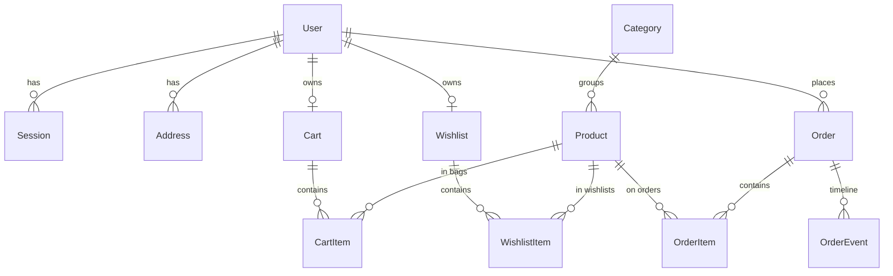

# AURELIA — Master Project Architecture Document (PAD) v1.0

**Classification:** Internal Engineering Reference
**Status:** DEFINITIVE, PRODUCTION-LOCKED BLUEPRINT
**Companion Documents:** `AGENTS.md` (agent commands/quirks), `CLAUDE.md` (agent workflow), `README.md` (user-facing overview)
**Last Updated:** 2026-10-14
**Audience:** Senior Engineers, Tech Leads, DevOps, and Onboarding Engineers
**Rule:** Every architectural decision in this document traces to a specific rationale. Nothing is here "because it's popular."

---

## Table of Contents

1. [System Overview & Decisions](#1-system-overview--decisions)
2. [High-Level System Topology](#2-high-level-system-topology)
3. [Application Architecture](#3-application-architecture)
4. [Data Architecture](#4-data-architecture)
5. [Design System Reference](#5-design-system-reference)
6. [Security Architecture](#6-security-architecture)
7. [Testing Strategy](#7-testing-strategy)
8. [Build & Deployment](#8-build--deployment)
9. [Developer Handbook](#9-developer-handbook)
10. [Known Issues & Outstanding Tasks](#10-known-issues--outstanding-tasks)
11. [Key Files Reference](#11-key-files-reference)
12. [Glossary](#12-glossary)

---

## 1. System Overview & Decisions

### 1.1 Document Metadata & Purpose

AURELIA (storefront brand: **VELOUR**) is a production-grade luxury fashion e-commerce application: storefront, customer accounts, and admin console. It is a **functional superset** of a visual-only reference prototype (`pastel-aurelia-fashion-edit.base44.app`) whose measured behavior is: working login, cart drawer, and search overlay only — every commerce button is inert and every catalog route 404s. The clone mandate is therefore twofold and non-negotiable:

1. **Visual parity** — resting-state pixels of every shared surface match the reference's computed styles.
2. **Functional superset** — every inert interaction becomes a real, server-backed commerce flow.

How to use this document: new engineers read §2–§4 for the mental model; debuggers start at §3.3 (invariants) and §10; reviewers of tech choices read §1.3 (ADRs).

### 1.2 Technology Stack Summary

| Layer | Technology | Version (pinned) | Key Rationale |
|---|---|---|---|
| Web framework | Next.js (App Router, Turbopack, standalone output) | 16.4.0 | RSC + server actions give a zero-API mutation seam; standalone ships a self-contained server |
| UI runtime | React | 19.3.0 | `useActionState` + adjust-state-during-render; Compiler-compatible patterns enforced by lint |
| Language | TypeScript (strict) | 5.9.3 | Action envelopes and DTOs typed end-to-end |
| Styling | Tailwind CSS v4 (CSS-first) | 4.3.3 | Reference extracted as v3-style bare HSL tokens; v4 `@theme inline` with full `hsl()` literals reproduces them exactly |
| ORM / DB | Prisma + SQLite | 6.19.3 | Single-writer file DB fits the demo/single-node scope; schema-relative URL contract |
| Validation | Zod | 3.25.76 | One schema language across forms, actions, admin updates |
| Auth | Custom scrypt + DB sessions | — | No external IdP dependency; reference has email/password only |
| Unit testing | Vitest (node env) | 3.2.7 | Fast pure-seam coverage (money, URL contract, schemas, limiter, HMAC) |
| E2E testing | Playwright | 1.64.0 | Boots the real production standalone against a scratch DB; chromium + mobile profiles |
| Icons | lucide-react | 0.545.0 | Same icon set as the reference (stroke width 2) |
| Fonts | Cormorant Garamond + Montserrat (self-hosted) | — | Reference typefaces; `@font-face` + `font-display: swap` in `public/fonts/` |

### 1.3 Architecture Decision Records

**ADR-001: Server actions are the only mutation seam**

- **Context:** The reference prototype performs mutations nowhere (inert buttons); the clone needs cart/checkout/wishlist/auth/admin writes with zero bespoke REST surface, and every write must be server-authoritative.
- **Decision:** All mutations live in `"use server"` modules under `src/lib/actions/`. Reads happen in RSC pages via Prisma directly. REST exists only for three read/subscribe endpoints (`/api/health`, `/api/search`, `/api/newsletter`).
- **Rationale:** Server actions give typed, CSRF-safe, progressively-enhanced mutations with no API layer to keep in sync; the repo-family architecture (ecommerce-store) proved the pattern at 4-endpoint REST whitelist scale.
- **Consequences:** (+) one place to audit writes; (+) client store always re-syncs from action DTOs (server truth wins); (−) actions are not curl-able — E2E must drive the UI.
- **Alternatives rejected:** REST route handlers + SWR mutations (duplicates validation + typing); tRPC (extra runtime for 8 actions).

**ADR-002: SQLite via schema-relative `DATABASE_URL`, re-anchored at runtime**

- **Context:** The database must live at `<repoRoot>/db/custom.db` regardless of which process opens it (dev server, seed script, standalone production server whose cwd is `.next/standalone`).
- **Decision:** `.env` pins `DATABASE_URL="file:../db/custom.db"` (the Prisma CLI's schema-relative form). `src/lib/db-path.ts` reproduces the CLI rule (walk up from cwd to the nearest `prisma/schema.prisma`, resolve the URL against it). `src/lib/db.ts` passes every URL through that resolver before constructing `PrismaClient`. Absolute `file:` URLs pass through untouched.
- **Rationale:** The generated client bakes the schema directory at generate time, which MOVES in the standalone bundle; the resolver makes dev, tooling, and the standalone agree on one physical file.
- **Consequences:** (+) one contract for all runtimes; (−) the resolver's `existsSync` reads make file tracing copy `prisma/schema.prisma` into the bundle — which would re-anchor relative URLs to `<bundle>/db/` (nonexistent). Hence the E2E webServer uses an absolute URL (pass-through path), and deployments must too.
- **Alternatives rejected:** absolute URL in `.env` (breaks the documented contract + tests); raw client default (broke in standalone: "Unable to open the database file").

**ADR-003: Custom scrypt auth with DB-backed sessions and HMAC cookies**

- **Context:** Email/password auth matching the reference's login card; no third-party IdP; rate-limitable.
- **Decision:** `scrypt` password hashing (`s1$<salt>$<hash>` format), `Session` rows in SQLite, session id inside an HMAC-signed httpOnly cookie (`AUTH_SECRET`), guest carts/wishlists keyed by 192-bit random tokens merged into the user's rows at login.
- **Rationale:** Zero external dependencies, full control over rate limiting and session revocation (logout deletes the row), and the guest→member merge maps 1:1 onto the cart token model.
- **Consequences:** (+) revocable, auditable, no vendor lock; (−) no OAuth (the Google button on the auth card is a visual parity stub, explicitly titled as such).
- **Alternatives rejected:** NextAuth (heavier than needed; reference has no OAuth); localStorage auth (the pre-transformation SPA's model — plaintext, unrevocable).

**ADR-004: Single client state seam (`StoreProvider`), server-truth re-sync**

- **Context:** Cart, wishlist, user, and four overlay states are consumed across many client islands; naive per-component fetching caused drift in the reference family.
- **Decision:** One React context (`StoreProvider`) initialized from server props; mutations return fresh DTOs that the caller writes back via `setCart`/`setWishlist`. Router refresh re-syncs via the adjust-state-during-render pattern (last-seen-props in state — no setState-in-effect).
- **Rationale:** Server actions are async and cheap; keeping the client cache as a mirror of action responses eliminates optimistic-math bugs (totals, counts) by construction.
- **Consequences:** (+) no client money math at all; (−) every mutation pays an action round-trip (acceptable at this scale).
- **Alternatives rejected:** Zustand (second state mechanism); optimistic updates (contradicts server-truth invariant).

**ADR-005: Tailwind v4 CSS-first with pinned parity literals**

- **Context:** The reference was built on Tailwind v3-style tokens (bare HSL triplets) and its mobile menu uses `flex flex-col gap-5` stacking. v4 changes both semantics (bare triplets resolve transparent; `space-y-*` rewrites its selector).
- **Decision:** All tokens are declared as full `hsl(...)` literals in `@theme inline` (`src/app/globals.css`); parity stacks use flex `gap-*` exclusively; fonts are self-hosted `@font-face`.
- **Rationale:** Computed-style parity is the product requirement; the pins are enforced by E2E geometry assertions (`tests/e2e/mobile-navigation.spec.ts` measures bounding boxes, not class names).
- **Consequences:** (+) byte-identical rendering semantics; (−) future maintainers must not "simplify" `gap-5` → `space-y-5` (the v4 trap the pins guard).

**ADR-006: Production standalone E2E with per-project auth sessions**

- **Context:** Dev-server E2E misses build/asset failures (and did: the standalone initially served SSR HTML with 404 chunks — zero hydration); rate limits punish per-test logins; the logout spec destroys server-side sessions.
- **Decision:** Playwright boots `.next/standalone/server.js` on :3100 against a scratch `db/e2e.db` (global-setup pushes schema + seeds). Two setup projects (`setup-chromium`, `setup-mobile`) each sign in once and persist `tests/e2e/.auth/{chromium,mobile}.json`. The webServer passes an absolute `DATABASE_URL` (ADR-002 pass-through).
- **Rationale:** Testing the shipped artifact; per-project sessions make projects order-independent despite session-revoking specs; one login per project stays under the 10/15min limiter.
- **Consequences:** (+) hydration/asset regressions are caught; (−) `npm run build` must precede `npm run test:e2e`.

**ADR-007: Demo card settlement without a PSP**

- **Context:** The reference has no payment provider; the clone must demo checkout end-to-end.
- **Decision:** Card orders are Luhn-validated, only the last 4 digits are stored, and payment is settled immediately (`paymentStatus: "paid"`); COD orders settle as `null` (courier). No real charge path exists.
- **Rationale:** Demonstrates the full order lifecycle (placed → in_transit → delivered) without SAQ scope or live keys.
- **Consequences:** (+) zero external integration; (−) obviously not production payment — documented here and in the checkout UI copy ("demo processor, no real charge").

## 2. High-Level System Topology

```text
┌────────────────────────────── Browser (chromium desktop / iPhone-14 profile) ──────────────────────────────┐
│  RSC payload (force-dynamic pages)  ·  Client islands (header, drawers, wizard)  ·  StoreProvider context   │
└───────────────┬──────────────────────────────────────────────────────────────────────────┬─────────────────┘
                │ GET (RSC/nav)                                                            │ POST server actions
┌───────────────▼──────────────────────────────────────────────────────────────────────────▼─────────────────┐
│  Next.js 16.4 server (dev: turbopack :3000 · prod: .next/standalone/server.js)                             │
│  ├─ (storefront) route group: + AnnouncementBar, Header, MobileNav, CartDrawer, SearchOverlay,             │
│  │                              Newsletter, Footer  (chrome composed in the group layout)                  │
│  ├─ (auth) route group: chrome-less login/register (measured slate cards)                                  │
│  ├─ /api/health · /api/search · /api/newsletter                     (the only REST endpoints)              │
│  ├─ security headers (next.config.ts): CSP (env-conditional: dev adds      │
│  │   'unsafe-eval'), Permissions-Policy, COOP, Referrer-Policy, nosniff,   │
│  │   HSTS, X-Frame-Options: DENY                                           │
│  ├─ src/instrumentation.ts ← boot-time env guard (AUTH_SECRET mandatory    │
│  │   in production)                                                        │
│  └─ src/lib/actions/*  ← THE mutation seam (Zod + authz + rate limits + transactions)                      │
└───────────────┬────────────────────────────────────────────────────────────────────────────────────────────┘
                │ Prisma 6.19 (datasource URL re-anchored via src/lib/db-path.ts)
       ┌────────▼─────────┐        ┌──────────────────────────┐
       │ SQLite (file)    │        │ External (static assets) │
       │  db/custom.db    │        │  images.unsplash.com     │
       │  13 models       │        │  (unoptimized passthrough)│
       └──────────────────┘        └──────────────────────────┘
```

Single-node, single-process, single-writer. Scaling characteristics are documented in §8.4; the rate limiter is in-memory (per-instance) by the same scope decision.

## 3. Application Architecture

### 3.1 The Layer Model

```
Layer 0: Database — SQLite file at <repoRoot>/db/custom.db. 13 Prisma models. Money = integer cents.
Layer 1: Domain seams (src/lib) — pure + server modules: money, db-path, cart (+ cart-dto), auth, rate-limit,
         validation (Zod), order-token, delivery, products (DTO mapper). Pure modules never import servers.
Layer 2: Mutation seam (src/lib/actions) — "use server" only. Zod-parse → authz → transaction → ActionResult<T>.
Layer 3: RSC pages (src/app) — force-dynamic server components; fetch via Prisma, render DTOs; route groups
         own chrome: (storefront) renders the full chrome, (auth) renders none.
Layer 4: Client islands (src/components) — interactivity only; state via StoreProvider; mutations via actions.
Golden rule: data flows DOWN (props), mutations flow UP (actions), and the client never derives money math.
```

### 3.2 Annotated Directory Structure

```text
luxury-fashion-store/
├── AGENTS.md / CLAUDE.md / README.md / Project_Architecture_Document.md
├── next.config.ts              ← standalone output, dev-origin allowlist, security headers
├── playwright.config.ts        ← standalone E2E on :3100, per-project auth, absolute e2e DB URL
├── vitest.config.ts            ← unit layer (matches *.test.ts only)
├── .env                        ← DATABASE_URL (schema-relative), AUTH_SECRET, NEXT_PUBLIC_SITE_URL
├── db/                         ← git-ignored; custom.db (dev) + e2e.db (E2E scratch)
├── prisma/
│   ├── schema.prisma           ← 13 models, SQLite, no enums (Zod-validated strings)
│   └── seed.ts                 ← deterministic (fixed scrypt salts) + idempotent (upserts)
├── scripts/
│   └── assemble-standalone.mjs ← postbuild: copies .next/static + public/ into the bundle
├── public/fonts/               ← self-hosted Cormorant Garamond + Montserrat (woff2)
├── docs/
│   ├── screenshots/            ← dev-server captures (parity evidence)
│   └── legacy-homenest/        ← archived Vite-SPA lineage (sessions, remediation history)
├── tests/e2e/                  ← Playwright: 8 spec files + global-setup + auth.setup
└── src/
    ├── instrumentation.ts      ← boot-time env guard (production fails fast without AUTH_SECRET)
    ├── app/
    │   ├── layout.tsx          ← minimal root shell (fonts, metadata)
    │   ├── globals.css         ← Tailwind v4 @theme (hsl literals), @font-face, v4 trap pins
    │   ├── not-found.tsx       ← measured 404 card
    │   ├── (auth)/login|register/page.tsx     ← chrome-less, force-dynamic, redirect-aware
    │   ├── (storefront)/layout.tsx            ← chrome composition point + StoreProvider init
    │   ├── (storefront)/page.tsx              ← home: 12 sections in reference order
    │   ├── (storefront)/shop/                 ← PLP (functional superset; deep-linkable filters)
    │   ├── (storefront)/product/[slug]/       ← PDP + JSON-LD + related row
    │   ├── (storefront)/cart/ checkout/ checkout/success/ wishlist/
    │   ├── (storefront)/account/ account/orders/[id]/
    │   ├── (storefront)/admin/ admin/orders/[id]/ admin/products/
    │   └── api/health|search|newsletter/route.ts
    ├── components/
    │   ├── store/              ← header, mobile-nav, cart-drawer, search-overlay, product-card,
    │   │                          product-detail, hero-carousel, shop-client, cart-page-client,
    │   │                          footer, newsletter, announcement-bar, store-provider, ...
    │   ├── checkout/           ← 3-step wizard (client)
    │   ├── account/            ← tabs (orders/addresses/profile/settings), auth-form
    │   └── ui/                 ← tabs.tsx (the one Radix primitive in use; dead primitives removed in session 3)
    └── lib/
        ├── db.ts / db-path.ts  ← Prisma singleton + URL re-anchoring (ADR-002)
        ├── cart.ts / cart-dto.ts ← server cart domain / pure DTO contract (ADR split)
        ├── auth.ts             ← scrypt, sessions, SafeUser, isAdmin, strict authSecret()
        ├── actions/            ← auth, cart, wishlist, checkout, account, admin ("use server")
        ├── action-result.ts    ← { ok, data | error{message, fieldErrors} } envelope
        ├── validation.ts       ← Zod schemas + validateRedirectPath + isLuhnValid
        ├── rate-limit.ts       ← in-memory fixed-window limiter (TRUST_PROXY-gated client IP)
        ├── order-token.ts      ← HMAC guest order-view capability tokens (authSecret()-backed)
        ├── address.ts          ← schema-checked shipping-address parser (no raw JSON.parse)
        ├── money.ts / delivery.ts / products.ts
        └── data/catalog.ts     ← reference-extracted catalog, slides, menus, demo users
```

### 3.3 Critical Code Patterns

**Pattern 1 — The action envelope (every write looks like this):**

```typescript
// src/lib/actions/cart.ts — server truth wins; the client never computes totals.
export async function addToCartAction(productId: string, size: string, quantity: number)
  : Promise<ActionResult<CartDto>> {
  const parsed = cartAddSchema.safeParse({ productId, size, quantity }); // 1. Zod at the seam
  if (!parsed.success) return fail("Invalid bag request.");
  const user = await getCurrentUser();                                   // 2. authz context
  // 3. DB writes (guest token rows mint 192-bit tokens; stock clamps)
  revalidatePath("/", "layout");                                         // 4. RSC freshness
  const dto = await getCartDto(user?.id ?? null);                        // 5. server-derived DTO
  return ok(dto);                                                        // 6. envelope back
}
```

*Why:* one auditable shape for all 15+ actions; the caller pattern (`startTransition` → `setCart(res.data)`) is identical everywhere.

**Pattern 2 — Adjust-state-during-render (React Compiler-safe re-sync):**

```typescript
// src/components/store/store-provider.tsx — server props re-sync WITHOUT effects.
const [cart, setCartState] = useState<CartDto>(initialCart);
const [lastCartProps, setLastCartProps] = useState<CartDto>(initialCart);
if (initialCart !== lastCartProps) {     // identity change from router.refresh()
  setLastCartProps(initialCart);
  setCartState(initialCart);             // React re-renders immediately; no effect needed
}
```

*Why:* `react-hooks/set-state-in-effect` is an error in this repo; this is the officially sanctioned pattern and survives the React Compiler.

**Pattern 3 — The guest↔user identity bridge:**

```typescript
// src/lib/cart.ts — carts/wishlists are keyed by a unique token, not by userId alone.
// user-owned rows ALSO mint tokens, so the row is addressable before/after claiming.
const created = await db.cart.create({ data: { userId, token: randomBytes(24).toString("hex") } });
```

*Why:* the guest cookie and the user row speak the same key language; login merges guest rows (quantity-max union) then deletes them.

**Pattern 4 — DTO contract split (client-safe types):**

```typescript
// src/lib/cart-dto.ts — PURE module (no server imports). Types + EMPTY constants only.
// src/lib/cart.ts — server-only (next/headers, Prisma) and re-exports the DTOs:
export type { CartLineDto, CartDto, WishlistDto } from "@/lib/cart-dto";
export { EMPTY_CART, EMPTY_WISHLIST } from "@/lib/cart-dto";
```

*Why:* `StoreProvider` (client) must import `CartDto`; importing the server module pulls `next/headers` into the browser graph — Turbopack fails the build. The split keeps one naming surface with two ownership zones.

**Pattern 5 — Wizard values survive unmounting:**

```typescript
// src/components/checkout/checkout-flow.tsx — card fields live in STATE, not the DOM:
const [card, setCard] = useState({ number: "", expiry: "", cvc: "" }); // controlled inputs
// step 2 unmounts the step-1 inputs; submit() reads `card`, never getElementById.
```

*Why:* the review step renders only a summary; DOM-reading at submit time returned null and silently broke every card order (caught by E2E, fixed at the root).

## 4. Data Architecture

### 4.1 Database Schema (13 models)



| Model | Key columns | Notes |
|---|---|---|
| `User` | email (unique), passwordHash (`s1$salt$hash`), role (`user`\|`admin`, Zod-checked) | demo: james (customer), admin |
| `Session` | userId, expiresAt, id (cuid in HMAC cookie) | logout deletes the row |
| `Address` | userId, label, fullName, street…, isDefault | checkout prefill source |
| `Category` | slug, label, sortOrder | 4: women, men, accessories, shoes |
| `Product` | slug, brand, price/compareAtPrice (cents), discount, sizes/colors/images (JSON strings), rating, reviewCount, isNew/isBestseller, stock, isActive, sortOrder | 12 seeded = catalog array order |
| `Cart` / `Wishlist` | **token (unique)**, userId (unique, nullable) | token = row identity for guest AND user rows |
| `CartItem` | cartId, productId, size, quantity | unique `(cartId, productId, size)` |
| `WishlistItem` | wishlistId, productId | unique pair |
| `Order` | number (`ORD-YYYY-NNN`), userId (nullable = guest), email, status, subtotal/shipping/total (cents), shippingAddress (JSON), paymentMethod, cardLast4, paymentStatus | guest views gated by HMAC token |
| `OrderItem` | orderId, productId, name/brand/image/size/unitPrice snapshots | immutable at purchase time |
| `OrderEvent` | orderId, type, actor (`system` \| `admin`, default `system`), createdAt | status timeline (placed → …); customer view hides `actor="admin"` notes |
| `NewsletterSubscriber` | email (unique) | `/api/newsletter` |

### 4.2 Persistence Strategy

- **Connection:** single `PrismaClient` singleton (HMR-safe `globalThis` cache); SQLite WAL defaults; no pool tuning needed at single-writer scope.
- **URL resolution:** every process re-anchors `DATABASE_URL` through `src/lib/db-path.ts` (ADR-002). E2E/deployments use absolute URLs (pass-through).
- **Transactions:** `placeOrderAction` re-reads stock, decrements it, allocates the order number (`count+1`, zero-padded, race-free on single-writer SQLite), and writes order+items+event atomically inside `db.$transaction`. Oversell throws `STOCK_SHORT` and fails the action.
- **Migrations:** `prisma db push` (prototype cadence). Seed is deterministic + idempotent; `db:setup` = push + seed.
- **Caching:** none — all routes `force-dynamic`; the client store mirrors action responses. `placeOrderAction` deliberately skips `revalidatePath` (it would re-render `/checkout` mid-action and its empty-cart `redirect("/cart")` races the success navigation).

## 5. Design System Reference

### 5.1 Typographic System

| Role | Face | Usage |
|---|---|---|
| Display / headings | Cormorant Garamond 300–600 (+italics), class `font-cormorant` | Logo (30px, ls 9px), section h2 (48–60px), PDP h1, prices in serif contexts |
| Body / UI | Montserrat 200–700, class `font-montserrat` | 16px/24px base; kickers `text-[10px] tracking-[0.3em] uppercase`; nav `text-xs tracking-[0.15em] uppercase` |

Both are self-hosted woff2 in `public/fonts/` with `@font-face` + `font-display: swap` in `globals.css` — no runtime Google Fonts dependency.

### 5.2 Color Tokens (extracted from the reference `:root`; v4 literals)

| Token | Value (hsl) | Computed anchor | Usage |
|---|---|---|---|
| background | `hsl(30 15% 97%)` | rgb(248,247,246) | page ground |
| foreground / primary | `hsl(25 15% 8%)` | rgb(23,20,17) | ink, header, footer |
| secondary | `hsl(30 20% 93%)` | — | subtle fills |
| muted-foreground | `hsl(25 10% 45%)` | — | secondary copy |
| accent / gold | `hsl(35 60% 55%)`, gold `hsl(42 75% 52%)` | — | SALE link, kickers, hover |
| border / input | `hsl(30 15% 88%)` | rgb(229,224,220) | hairlines |
| cream | `hsl(38 40% 96%)` | — | alternating section bands |
| destructive | `hsl(0 84.2% 60.2%)` | — | form errors, remove |

⚠️ The reference ships these as **bare HSL triplets** (v3 style). In v4 they MUST be full `hsl()` literals in `@theme inline` — bare triplets resolve transparent. This is pinned in `globals.css` comments and `AGENTS.md`.

### 5.3 Component Primitives

shadcn-style local primitives in `src/components/ui/` (button, input, label, tabs, card, separator) — Radix behavior without a registry dependency; styled to the measured geometry (e.g. size chips `text-[10px] px-2.5 py-1.5 border-border`, active = `border-foreground`). Icons: lucide-react, stroke width 2, 18–20px header cluster.

### 5.4 Motion / Animation

Hero crossfade `transition-opacity duration-700`, auto-rotate 5000ms; drawers/overlays render via conditional mount (no measured reference motion to replicate); `prefers-reduced-motion` respected by Tailwind transitions. The 404/hero arrows/dots geometry (w-10 h-10 arrows, w-2 h-[2px] dots active w-8) is pinned from measurement.

## 6. Security Architecture

### 6.1 Security Rules

| Rule | Enforcement |
|---|---|
| All writes via server actions (no ad-hoc endpoints) | `"use server"` modules only; REST = 3 whitelisted read routes |
| Every input Zod-validated at the seam | `src/lib/validation.ts`; actions reject before touching the DB |
| Passwords never stored/returned in plaintext | scrypt `s1$salt$hash`; only `SafeUser` crosses to the client |
| Sessions revocable + HMAC-protected cookies | DB `Session` rows; httpOnly/sameSite=lax/secure-in-prod |
| Rate-limited unauthenticated writes | login 10/15min, register, newsletter, checkout (in-memory fixed window) |
| Open-redirect defense on auth redirects | `validateRedirectPath` (same-origin, no `//`, no CRLF) |
| Guest order pages need capability tokens | HMAC `orderViewToken` (sequential numbers are not capabilities) |
| Stock oversell impossible | re-read + decrement inside the checkout transaction |
| Clickjacking / sniffing / referrer hardening | `X-Frame-Options: DENY`, `nosniff`, `Referrer-Policy` via next.config headers |
| Card data minimization (demo PSP) | Luhn check; only last 4 stored; no PAN persistence |

### 6.2 Authentication & Authorization

- **Login:** scrypt verify → create `Session` row → signed httpOnly cookie (`aurelia_session`) → merge guest cart/wishlist (quantity-max union) → `redirect` validated path.
- **Authorization:** `getCurrentUser()` re-hydrates from the session row per request; admin pages additionally call `isAdmin()` server-side on every request (role never trusted from the client).
- **Ownership checks:** cart/wishlist/admin actions verify row ownership (guest rows via cookie token, user rows via userId).

### 6.3 Threat Model (top vectors)

| Vector | Mitigation |
|---|---|
| Credential stuffing / brute force | rate limiter + scrypt cost |
| Session theft | httpOnly + sameSite=lax + secure(prod) + HMAC integrity |
| CSRF on mutations | Next server actions' origin-checked POST + sameSite cookies |
| IDOR on orders | owner (userId) or HMAC view token; admin role re-checked per request |
| XSS | React escaping; no `dangerouslySetInnerHTML` except JSON-LD built from trusted catalog data |
| SQL injection | Prisma parameterized queries only |
| Open redirect at login | `validateRedirectPath` allowlist |

## 7. Testing Strategy

### 7.1 Test Distribution

| Category | Files | Tests | Location | Framework |
|---|---|---|---|---|
| Unit (pure seams) | 7 | 64 | `src/lib/*.test.ts` | Vitest (node) |
| E2E setup | 1 | 1×2 projects | `tests/e2e/auth.setup.ts` | Playwright |
| E2E functional | 8 | 62 runs | `tests/e2e/*.spec.ts` | Playwright (chromium + iPhone-14 profiles) |

E2E coverage map: home (hero/sections/newsletter) · shop (filters/sort/sale/search/clear) · product (gallery/chips/steppers/drawer/related) · cart+checkout (drawer steppers, empty state, totals, COD end-to-end) · auth (login card, wrong-password alert, register validation, logout) · wishlist (PDP toggle → page) · **mobile navigation (v4-trap geometry pins: 320px panel, flex gap 20px, stacking, navigation, Escape/backdrop close)** · admin (role gate + console pages).

### 7.2 Test Patterns

- **Unit = pure seams only** (money math, URL resolution, schemas, limiter, HMAC, delivery) — no DB, no DOM.
- **E2E = the real artifact:** production standalone boots on :3100 against `db/e2e.db` (schema + seed via `global-setup.ts`); assertions target user-visible reality (roles, labels, `data-testid`, bounding boxes) — never implementation classes, except where a pin IS the contract (mobile nav tracking classes).
- **Shared-DB discipline:** specs share one seeded DB and demo user → assertions use deltas, not absolute counts; specs tolerate guest mode (the COD spec fills the email field when rendered).

### 7.3 Pre-Deploy Checklist

```bash
npm run verify      # typecheck → lint → 52 unit → production build (+ standalone assembly)
npm run test:e2e    # 64 runs across chromium + mobile; requires the fresh build
```

Both green = shippable. `npm run build` must re-run after ANY source change before E2E (the suite tests the built artifact, not dev).

## 8. Build & Deployment

### 8.1 Production Build

```bash
npm run build
# = next build (turbopack, output: "standalone")
# + node scripts/assemble-standalone.mjs  (copies .next/static + public/ into .next/standalone/)
```

Without the assemble step the standalone serves SSR HTML whose `/_next/static` chunks 404 — pages render but never hydrate (every click inert). This failure mode is exactly what the Playwright mobile project caught; the step is wired into the build script so it cannot be forgotten.

### 8.2 Environment Variables

| Variable | Required | Description | Default |
|---|---|---|---|
| `DATABASE_URL` | yes | Schema-relative SQLite URL; absolute `file:` URLs pass through unchanged | `file:../db/custom.db` |
| `AUTH_SECRET` | yes (prod) | Session-cookie HMAC secret | dev fallback constant |
| `NEXT_PUBLIC_SITE_URL` | no | Canonical/og:url + sitemap origin | `http://localhost:3000` |
| `E2E_PORT` | no | Playwright standalone port | `3100` |

### 8.3 Runtime

```bash
PORT=3000 NODE_ENV=production AUTH_SECRET=<32B secret> \
  DATABASE_URL="file:<ABSOLUTE>/db/custom.db" \
  node .next/standalone/server.js
```

Use an **absolute** `DATABASE_URL` in deployment: file tracing copies `prisma/schema.prisma` into the bundle, so a relative URL would re-anchor to `<bundle>/db/` (ADR-002). Health probe: `GET /api/health` → `{"ok":true,"db":true}`.

### 8.4 Scaling Notes

Single-node, single-writer SQLite, in-memory rate limiter. Horizontal scale would require: shared Postgres (Prisma provider swap), a shared rate-limit store (Redis), and object storage for media — the seams are isolated for exactly this swap (`db.ts`, `rate-limit.ts`, `images.unsplash.com` remote patterns), but no such deployment exists today.

## 9. Developer Handbook

### 9.1 Local Setup

```bash
npm install
npm run db:setup     # push schema + deterministic seed
npm run dev          # http://localhost:3000 (turbopack)
```

Verify: `{"ok":true,"db":true}` from `/api/health`; `/login` shows the measured card with demo credentials.

### 9.2 Common Commands

See the table in `AGENTS.md` (source of truth for commands). Frequency-ordered: `npm run dev` · `npm run verify` · `npm run test:e2e` · `npm run db:setup`.

### 9.3 Code Style Rules

- ESLint 9 flat config (`eslint.config.mjs`): typescript-eslint recommended + react-hooks (**`set-state-in-effect` = error**) + next/native warnings. Non-type-aware (tsc covers types).
- TS strict; no `any`; DTOs and action envelopes typed end-to-end.
- Formatting: prettier-compatible defaults as written; no formatter config file (keep diffs minimal).

### 9.4 Git Workflow

Single-branch (main) with atomic, descriptive commits; the pre-push gate is `npm run verify && npm run test:e2e`. CI parity: the E2E suite is self-hosting (boots its own server + DB), so a single CI step chain — install → build → verify → e2e — reproduces the full gate.

## 10. Known Issues & Outstanding Tasks

| Priority | Issue | Impact | Status |
|---|---|---|---|
| LOW | Google button on the auth card is visual-only (title explains it) | Parity stub, documented | Accepted (ADR-003) |
| LOW | Rate limiter is in-memory (single-instance) | Multi-node deployments need a shared store | Documented (§8.4) |
| LOW | Catalog images are Unsplash stock; 3 dead URLs were replaced with verified ones | Cosmetic | Closed 2026-10-14 |
| LOW | `package.json` declares `next ^16.0.0` while 16.4.0 is installed (caret range) | Reproducibility | Open — pin exact versions when toolchain stabilizes |
| INFO | Demo card settlement is instantaneous ("paid") | No real PSP | Accepted (ADR-007) |

## 11. Key Files Reference

| File | ~Lines | Purpose |
|---|---|---|
| `src/app/globals.css` | ~200 | Tailwind v4 theme (hsl literals), @font-face, v4 trap pins |
| `src/app/(storefront)/layout.tsx` | 49 | Chrome composition + StoreProvider server-truth init |
| `src/components/store/store-provider.tsx` | 106 | Single client state seam (adjust-during-render) |
| `src/components/store/header.tsx` | 142 | Sticky chrome, dropdowns, icon cluster, badges |
| `src/components/store/mobile-nav.tsx` | 103 | Parity-critical drawer (flex gap-5 pin) |
| `src/components/checkout/checkout-flow.tsx` | ~300 | 3-step wizard; card state; startTransition dispatch |
| `src/lib/actions/checkout.ts` | ~200 | Transactional order placement (P2002 retry), stock guard, HMAC tokens |
| `src/lib/cart.ts` / `cart-dto.ts` | 230/40 | Server cart domain / pure DTO contract |
| `src/lib/db-path.ts` | 62 | Schema-relative URL resolution (pinned by tests) |
| `src/lib/validation.ts` | ~120 | Zod schemas, redirect guard, Luhn |
| `prisma/schema.prisma` | ~160 | 13 models |
| `prisma/seed.ts` | 280 | Deterministic catalog/users/orders fixtures |
| `playwright.config.ts` | ~95 | Standalone E2E harness, per-project auth |
| `tests/e2e/mobile-navigation.spec.ts` | ~90 | The v4-trap geometry pins |
| `scripts/assemble-standalone.mjs` | 40 | Postbuild static-asset assembly |

## 12. Glossary

| Term | Meaning |
|---|---|
| **Parity surface** | A UI region whose resting visuals must match the measured reference (announcement bar, header, hero, card, mobile nav, drawer, overlay, footer, auth cards) |
| **Superset** | Functionality the reference lacks but the clone implements (PLP/PDP/checkout/accounts/admin) |
| **Action seam** | `src/lib/actions/*` — the only mutation path; Zod + authz + transactions |
| **Envelope** | `ActionResult<T>` = `{ ok: true, data } \| { ok: false, error: { message, fieldErrors? } }` |
| **Schema-relative URL** | `file:../db/custom.db` resolved against the nearest `prisma/schema.prisma` (CLI rule, reproduced at runtime) |
| **v4 trap pin** | A Tailwind-CSS-v4 semantic difference (hsl literals, `space-y` rewrite) guarded by tests/comments |
| **View token** | HMAC capability token letting a guest view one order confirmation |
| **Adjust-during-render** | React pattern: re-sync state during render when props change identity (no effects) |
