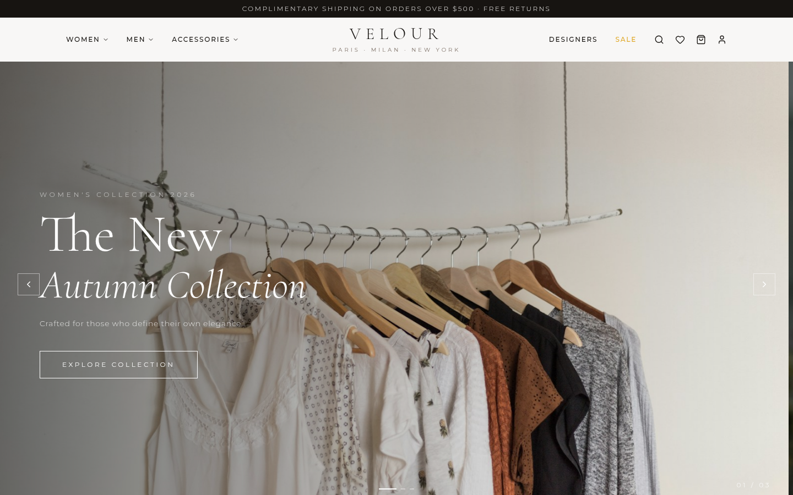
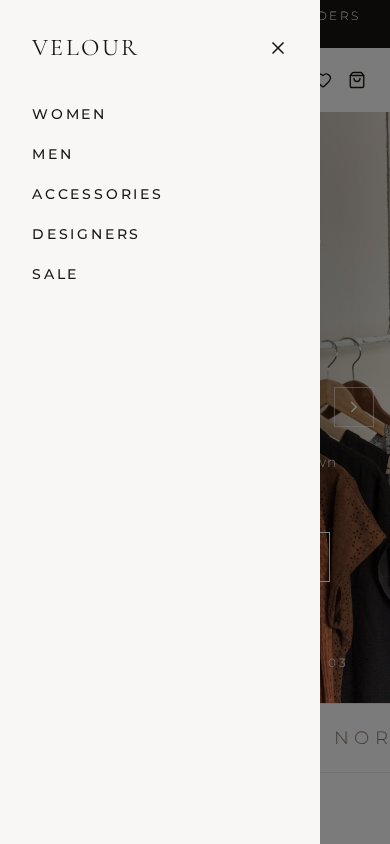

# AURELIA — Luxury Fashion E-Commerce (VELOUR)

     

A production-grade luxury fashion storefront + admin console — a **functional superset** of the reference prototype `pastel-aurelia-fashion-edit.base44.app` with resting-state visual parity: full catalog, cart, guest+member checkout, wishlist, customer accounts, and a role-gated admin, where the reference shipped inert buttons and two pages.

| Storefront | Mobile navigation |
|---|---|
|  |  |

## Overview

The reference site is a polished **visual prototype**: working login, cart drawer and search overlay — but every commerce action (`Add to Bag`, category cards, wishlist) is inert, and every catalog route 404s. This codebase reproduces its look (measured computed styles: Cormorant Garamond + Montserrat — every heading rank, card names included, renders the display serif — warm-paper palette, gold accents, per-slide left/right/center-anchored hero with a horizontal push transition, the brand marquee strip, the composite Exclusive Deals section — merged header row with the right-stacked live countdown + bento tiles + inline sale grid, fixed-width product-row cards with the measured text stack (Cormorant name, stroke stars, color swatches, size chips, discount chips), the five-item `w-80` mobile drawer with `flex gap-5` stacking) on a real architecture — Next.js 16 App Router, server actions as the single mutation seam, Prisma/SQLite persistence, scrypt+session auth — and makes every interaction real.

## Key Features

| Feature | Description |
|---|---|
| Home (12 sections) | Hero carousel (per-slide left/right/center-anchored slides), brand marquee, The Edit, product rows, **Exclusive Deals composite (merged header + right-stacked live countdown + bento + inline sale grid)**, UGC — reference order + copy |
| Shop (PLP) | Working category chips, price buckets, sort, sale filter, search, URL sync (reference `/shop` 404s) |
| Product detail | Gallery, size/color chips, quantity stepper, live stock, related row, JSON-LD (reference has no PDP; the buy panel speaks the card language — stroke stars, red-500 discount chip) |
| Cart | Drawer + full page, server-truth totals, guest carts (192-bit cookie token) merged at login |
| Checkout | 3-step wizard (Shipping → Payment → Review), card (Luhn-verified demo) + COD, stock decrement + oversell guard in one transaction |
| Orders | Guest confirmations via HMAC view tokens; account order history with status timeline |
| Wishlist | DB-backed per user/guest cookie, heart toggles re-sync from action responses |
| Auth | scrypt password hashing, DB sessions, HMAC cookies, rate-limited endpoints, open-redirect-safe redirects |
| Admin | Role-gated dashboard, order management (status/tracking), product stock/activation |
| Brand metadata | Swan favicon/apple icon (vector-authored in the measured palette), 1200×630 og share card, per-product og:image, PWA manifest (`/manifest.webmanifest`), immutable font caching |
| Store-root identity & transport | WebSite + Organization JSON-LD (the reference-measured graphs, nonce-carrying data blocks), first-paint font preloads (crossorigin), `theme-color` browser-chrome tint, RFC 9116 `/.well-known/security.txt` |
| Auth identity, canonicals & product OG | Auth pages carry the reference-measured WebSite + Organization + BreadcrumbList graphs (nonce-carrying); canonical links on the indexable surfaces; per-product `product:price:*` share metas |
| API | `/api/health`, `/api/search` (typeahead), `/api/newsletter` — the only REST endpoints (reads only) |

## Architecture

| Layer | Technology | Version | Purpose |
|---|---|---|---|
| Web framework | Next.js App Router (standalone output) | 16.4.0 | RSC pages, server actions, route groups |
| UI runtime | React | 19.3.0 | Client islands via one `StoreProvider` |
| Language | TypeScript (strict) | 5.9.3 | End-to-end types incl. action envelopes |
| Styling | Tailwind CSS v4 (CSS-first) | 4.3.3 | Design tokens as `hsl()` literals in `@theme` |
| ORM / DB | Prisma + SQLite | 6.19.3 | 13 models, single-file DB at `db/custom.db` |
| Auth | Custom scrypt + DB sessions | — | HMAC-signed httpOnly cookies |
| Validation | Zod | 3.25.76 | Every seam (forms, actions, admin updates) |
| Testing | Vitest 3.2.7 + Playwright 1.64.0 | — | 173 unit + 106 E2E cases × 2 device projects (incl. an automated axe a11y gate across logged-out, logged-in, AND admin surfaces, a CSP/JSON-LD security gate, an action-seam security gate — crafted server-action POSTs over the wire — an SEO metadata gate serving the documented sitemap/robots contract, a failure-surfaces gate pinning the 404 card and the RSC-fallback hard-navigation contract, and a brand-metadata gate pinning the swan mark, the og share card, the PWA manifest body, the immutable font cache, the store-root JSON-LD, the font preloads, the theme-color tint, the security.txt contract, the auth-page identity + breadcrumb graphs, the canonical links, and the product-price metas) |

```text
Browser ── RSC pages (force-dynamic)
   │        └─ Server Actions (only mutation seam, Zod-validated)
   │             └─ Prisma ── SQLite (db/custom.db, schema-relative URL)
   └─ StoreProvider (single client seam; re-syncs from action DTOs)
```

Deep dive: [`Project_Architecture_Document.md`](Project_Architecture_Document.md) · agent handbook: [`AGENTS.md`](AGENTS.md) · [`CLAUDE.md`](CLAUDE.md) · distilled engineering skill: [`luxury-fashion-store_SKILL.md`](luxury-fashion-store_SKILL.md)

## Quick Start

Prerequisites: **Node.js ≥ 20** (tested on 24), npm.

```bash
git clone git@github.com:nordeim/luxury-fashion-store.git
cd luxury-fashion-store
npm install
npm run db:setup      # create + seed db/custom.db (12 products, demo users)
npm run dev           # http://localhost:3000
```

Verify: `curl localhost:3000/api/health` → `{"ok":true,"db":true}`.

Demo accounts (printed on `/login` in development only — hidden in production builds since session 3, F-5):

| Role | Email | Password |
|---|---|---|
| Customer | `james@example.com` | `Demo1234!` |
| Admin | `admin@aurelia.com` | `Admin1234!` |

## Testing

```bash
npm run verify        # typecheck → lint → vitest (173) → production build
npm run test:e2e      # Playwright: boots the production standalone (build FIRST — 106 cases × 2 projects, +2 setup)
npx playwright test tests/e2e/mobile-navigation.spec.ts   # single spec
npx vitest run src/lib/money.test.ts                      # single unit file
```

The E2E suite boots the **production standalone** on `:3100` against its own `db/e2e.db`; run `npm run build` first whenever source changed. Mobile coverage runs the same Chromium engine on the iPhone 14 profile (the one desktop-only geometry pin skips there). Global setup re-seeds the scratch DB **and wipes transient state** (carts/wishlists/sessions) so every run starts canonical.

## Environment Variables

| Variable | Required | Description |
|---|---|---|
| `DATABASE_URL` | yes | Schema-relative SQLite URL — `file:../db/custom.db` (resolves to `<repoRoot>/db/custom.db`) |
| `AUTH_SECRET` | yes in prod | Session-cookie HMAC secret (`openssl rand -base64 32`) |
| `NEXT_PUBLIC_SITE_URL` | no | Canonical/og:url + sitemap origin (default `http://localhost:3000`) |
| `TRUST_PROXY` | no | Set `=1` only behind a trusted proxy that **overwrites** `x-forwarded-for` — enables per-client rate-limit identity |

## Production Build & Deploy

```bash
npm run build          # next build + scripts/assemble-standalone.mjs
PORT=3000 NODE_ENV=production AUTH_SECRET=<secret> DATABASE_URL="file:<absolute>/db/custom.db" \
  node .next/standalone/server.js
```

`output: "standalone"` emits a self-contained server; the build's assemble step copies `.next/static` + `public/` into it (the step the Next.js docs require). On a real deployment pass an **absolute** `DATABASE_URL` — file tracing copies `prisma/schema.prisma` into the bundle, which would re-anchor a relative URL to a nonexistent `<bundle>/db/` path. Security headers (Referrer-Policy, nosniff, HSTS, `X-Frame-Options: DENY`) ship from `next.config.ts`; the CSP is minted **per-request with a nonce** by `src/proxy.ts` (production `script-src 'self' 'nonce-…'` — no `unsafe-inline`; dev keeps the React-runtime escape hatch), pinned by `src/lib/csp.ts` unit tests + the `security-csp.spec.ts` E2E gate. If you set `TRUST_PROXY=1`, the proxy must **overwrite** (not append) `x-forwarded-for` — the rate limiter reads the first hop.

## Project Status

| Phase | Status | Notes |
|---|---|---|
| Reference recon (computed-style spec) | ✅ | `recon` artifacts + measured pins |
| Transformation to Next.js 16 | ✅ | Vite SPA lineage archived in `docs/legacy-homenest/` |
| Functional superset (PLP/PDP/cart/checkout/account/admin) | ✅ | All commerce paths live |
| Test suites (vitest + playwright) | ✅ | 173 unit · 106 E2E × 2 + 2 setup (incl. the axe a11y gate, 14 surfaces incl. logged-in + admin, the CSP/JSON-LD gate, the action-seam security gate, the SEO metadata gate, the failure-surfaces gate, and the brand-metadata gate), all green |
| Docs (AGENTS/CLAUDE/README/PAD + distilled SKILL.md) | ✅ | This release |

## License

Proprietary — internal reference implementation.
